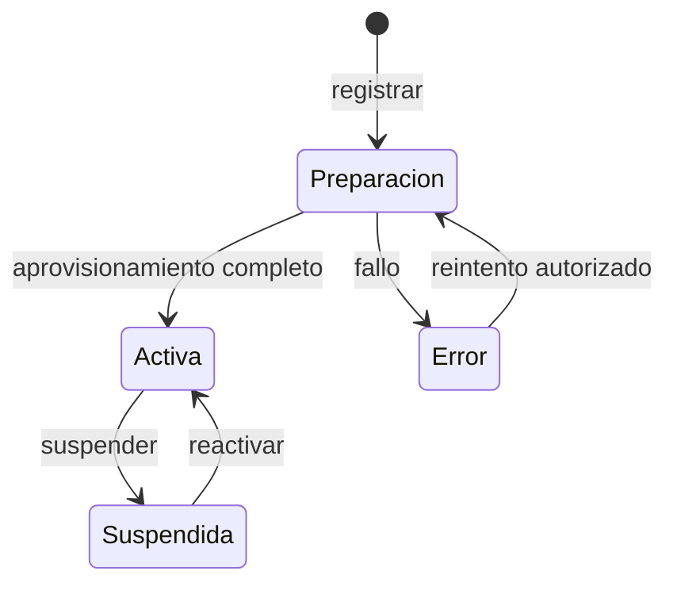
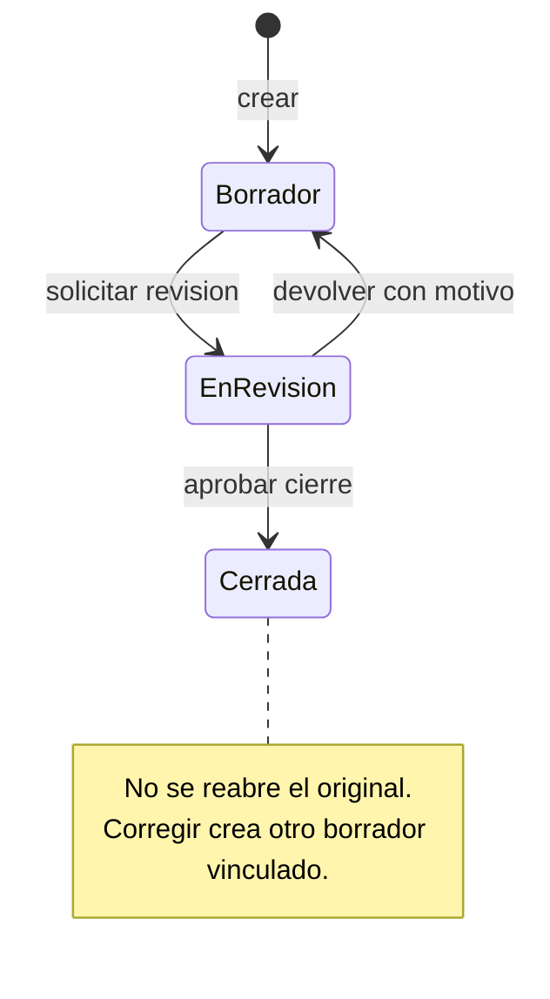
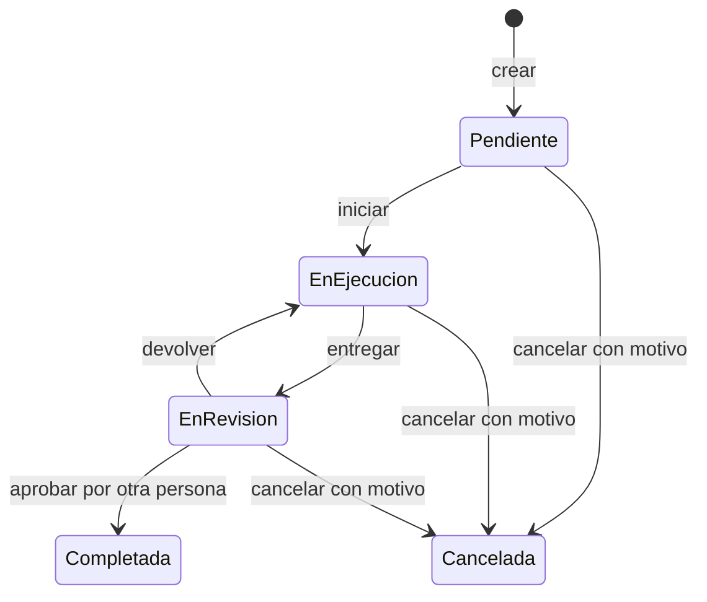

# Estados y transiciones

Versión: 0.4 — Aprobaciones APR-01 a APR-04; pendientes acotados
Fecha: 6 de noviembre de 2026
Relacionados: [Requerimientos](01-parametros-y-requerimientos.md), [Permisos](02-matriz-de-permisos.md), [Casos de uso](03-casos-de-uso.md), [Reglas de cálculo](04-reglas-de-calculo-y-valoracion.md), [Diccionario de datos](05-diccionario-de-datos-y-validaciones.md).

## 1. Propósito y alcance

Precisar cambios de estado, actores, condiciones y efectos. APR-02 aprueba mantener recorridos y ciertas precisiones destacadas; el estado por precisión se identifica en sección 15. Los detalles auxiliares no debatidos no se aprueban solo por documentarlos.

Una transición no reemplaza un permiso. Todas las condiciones son acumulativas: una acción visible puede rechazarse si cambió membresía, estado o revisión. APR-02 aprueba máximo de activos, notas y promedio por control, categorías de riesgo, residual documentado y mínimos de evidencia/cierre. Las rúbricas específicas, vigencia y otras partes todavía abiertas de DEC siguen pendientes; no hay PHVA ponderado ni descuentos automáticos en v1.

Actores: AP = administrador de plataforma; AE = administrador de empresa; GS = gestor de seguridad; RA = responsable de acciones; AU = auditor/lector. «Responsable actual» significa usuario con membresía activa AE, GS o RA y asignación vigente a la tarea. «Sistema» ejecuta un proceso autorizado o deriva un estado del tiempo; no puede eludir las condiciones de negocio.

APR-01 aprueba uno o varios roles por membresía: «AE/GS/RA» indica que al menos uno está presente en la empresa activa, no una membresía por rol. Las concesiones se combinan localmente; las restricciones de identidad, objeto y estado prevalecen. AU+GS puede editar por GS; AU solo no puede. No existe cambio de rol de pantalla que permita autoaprobar tareas.

`Nuevo` indica ausencia de registro, no un estado persistido. «Sin cambio» indica una operación con efecto o un nuevo registro vinculado, no un salto de estado. Una transición no listada se deniega. Los diagramas ilustran recorridos principales; las tablas establecen las condiciones completas.

## 2. Contrato común de transición

Para cada solicitud de cambio:

1. Identificar usuario, operación, empresa explícita y registro. En identidad o plataforma se usa el ámbito correspondiente; no se exige una membresía inexistente para aceptar una invitación inicial.
2. Comprobar cuenta/sesión, empresa operable, membresía, permiso y acceso al objeto. AP solo actúa sobre ciclo de vida y metadatos; no recibe contenido operativo.
3. Validar estado de origen, revisión esperada y referencias locales. Las solicitudes de una pestaña no heredan silenciosamente otra empresa elegida en otra pestaña.
4. Validar campos, fechas, evidencias disponibles, metodología aprobada cuando corresponda y restricciones de identidad de revisor.
5. Confirmar atómicamente el estado, los datos vinculados y el evento de historial de negocio. El almacenamiento de archivos y aprovisionamiento pueden requerir pasos técnicos separados: ningún paso parcial habilita acceso como si hubiera concluido.
6. Devolver estado y revisión resultantes; si falla, conservar el estado anterior y explicar los pendientes autorizados sin revelar datos ajenos.

El evento registra actor, instante, empresa/ámbito, objeto, operación, estado anterior/destino, motivo cuando aplica y correlación. Se representa en DD-25 o historial técnico de ámbito separado. Tokens, contraseñas y contenido completo de archivos no se registran.

### Reintentos y simultaneidad

- Una decisión terminal no se ejecuta dos veces. Una repetición identificable puede responder «ya realizada» sin duplicar efecto; una solicitud desactualizada distinta recibe conflicto. El mecanismo de idempotencia se definirá en arquitectura.
- Consumo de comprobante, actualización de estado y creación de membresía deben impedir dos aceptaciones exitosas; la revisión de tarea y el control del último AE se comprueban en la operación atómica.
- Autorizar al abrir un formulario no basta: si se revoca acceso antes de confirmar, rechazar la nueva operación. El diseño técnico fijará cómo coordinar una operación ya en curso con una revocación concurrente.
- Suspender una empresa bloquea nuevas operaciones empresariales; no borra información ni garantiza retirar archivos ya descargados. Un proceso técnico solo puede continuar si su finalidad y acceso están autorizados, sin publicar datos empresariales durante la suspensión.

## 3. Empresa y aprovisionamiento

**Datos:** DD-01. **Flujos:** CU-01/CU-02. **Permisos:** PER-01 a PER-03.

| ID | Origen → destino | Operación | Actor | Condiciones | Efectos |
| --- | --- | --- | --- | --- | --- |
| TR-EMP-01 | Nuevo → En preparación | Registrar empresa | AP | Datos mínimos válidos, identificación técnica única | Reservar empresa/esquema interno; sin acceso operativo |
| TR-EMP-02 | En preparación → Activa | Concluir aprovisionamiento | Sistema, por alta autorizada AP | Esquema completo y compatible, configuración lista, invitación inicial emitida de forma recuperable | Activar; el primer AE solo accede tras aceptar invitación |
| TR-EMP-03 | En preparación → Error de aprovisionamiento | Registrar fallo | Sistema | Fallo de estructura/configuración o imposibilidad de completar emisión inicial | Guardar referencia técnica restringida; impedir acceso parcial |
| TR-EMP-04 | Error de aprovisionamiento → En preparación | Reintentar alta | AP, con ejecución técnica | Revisar causa, reutilizar identidad reservada, no crear esquema duplicado | Ejecutar pasos pendientes de forma idempotente |
| TR-EMP-05 | Activa → Suspendida | Suspender | AP | Motivo obligatorio y revisión vigente | Bloquear siguientes solicitudes empresariales, incluidas sesiones existentes |
| TR-EMP-06 | Suspendida → Activa | Reactivar | AP | Motivo, esquema completo/compatible y comprobaciones técnicas satisfactorias | Permitir operaciones solo a membresías todavía vigentes |

Repetir suspensión no elimina datos. No hay transición a eliminada en versión inicial. La activación puede preceder a la aceptación del primer AE: la empresa sigue sin usuario empresarial autorizado hasta TR-INV-02/TR-MEM-01. Se propone tratar el fallo de emisión inicial como alta incompleta; el detalle de entrega y recuperación dependerá del canal aprobado.

## 4. Invitación

**Datos:** DD-04. **Flujos:** CU-01/CU-07/CU-08. **Permisos:** PER-09/PER-11; AP solo invitación inicial.

| ID | Origen → destino | Operación | Actor | Condiciones | Efectos |
| --- | --- | --- | --- | --- | --- |
| TR-INV-01 | Nuevo → Pendiente | Emitir | AE; AP para primer AE | Destinatario y conjunto empresarial válido no vacío; AP inicial ofrece solo AE; vencimiento definido | Vincular comprobante al conjunto ofrecido y empresa; sin acceso aún |
| TR-INV-02 | Pendiente → Aceptada | Aceptar | Destinatario verificado | Empresa activa, identidad coincidente, comprobante válido no consumido/revocado y hora actual anterior a vence_en | Consumir comprobante y crear membresía una sola vez |
| TR-INV-03 | Pendiente → Revocada | Revocar | AE | Empresa operable, invitación de su empresa aún pendiente | Inutilizar comprobante y registrar actor |
| TR-INV-04 | Pendiente → Vencida | Alcanzar vencimiento | Sistema | Hora actual mayor o igual a vence_en; no aceptada ni revocada antes | Denegar aceptación sin depender de una tarea programada |

Aceptada, revocada y vencida son terminales. Una nueva invitación es otro registro; no se renueva un enlace terminal. La precedencia de representación es aceptada o revocada según evento registrado, y vencida solo si no hubo consumo/revocación previa. La interfaz no muestra una aceptada como vencida después de su fecha límite.

La suspensión no detiene el reloj. Si el comprobante sigue vigente al reactivar la empresa, puede aceptarse entonces. No se acepta una invitación antigua para cambiar un rol o reactivar una membresía revocada.

## 5. Membresía

**Datos:** DD-03. **Flujos:** CU-07/CU-08. **Permisos:** PER-10/PER-11.

| ID | Origen → destino | Operación | Actor | Condiciones | Efectos |
| --- | --- | --- | --- | --- | --- |
| TR-MEM-01 | Nuevo → Activa | Incorporar miembro | Sistema tras aceptación válida | TR-INV-02, identidad verificada, pareja empresa/usuario inexistente y conjunto ofrecido válido | Crear una membresía y asignar solo roles de la invitación en esa empresa |
| TR-MEM-02 | Activa → Activa | Añadir o retirar roles | AE | Conjunto AE/GS/RA/AU sin duplicados ni vacío; motivo; conservar al menos una membresía activa con AE | Guardar conjuntos anterior/nuevo, recalcular permisos y señalar tareas si pierde todos los roles elegibles |
| TR-MEM-03 | Activa → Revocada | Revocar pertenencia | AE | Motivo, pertenencia local y conservación del último AE activo | Retirar acceso en nuevas solicitudes, preservar autoría y tareas históricas |

No se ofrece transición revocada → activa hasta especificar readmisión. Otra invitación no elude esta restricción. La excepción temporal de empresa recién creada sin AE aceptado pertenece al alta, no permite revocar al último AE después de incorporarlo.

Cambiar rol o revocar no borra ni completa tareas. Si el responsable deja de ser elegible, la tarea conserva su estado y recibe indicador de responsable no disponible; AE/GS debe resolver la asignación. La membresía de la persona en otras empresas permanece intacta.

## 6. Activos, procesos y responsables de negocio

**Datos:** DD-09/DD-10/DD-11. **Flujos:** CU-09/CU-10/CU-12. **Permisos:** PER-13/PER-15/PER-17.

| ID | Origen → destino | Operación | Actor | Condiciones | Efectos |
| --- | --- | --- | --- | --- | --- |
| TR-ARC-01 | Nuevo → Activo | Crear activo | AE o GS | Campos mínimos de DD-11, código único local, proceso/propietario válidos | Crear ficha; clasificación puede seguir pendiente |
| TR-ARC-02 | Activo → Archivado | Archivar activo | AE o GS | Motivo y revisión vigente; mostrar dependencias abiertas antes de confirmar | Retirar de nuevas asignaciones y conservar referencias, riesgos y tareas existentes |
| TR-ARC-03 | Archivado → Activo | Restaurar activo | AE o GS | Motivo, código reservado sin conflicto; revisar referencias actuales antes de nuevas asignaciones | Recuperar disponibilidad para nuevas operaciones, sin reabrir riesgos cerrados |
| TR-ARC-04 | Nuevo → Activo | Crear proceso o responsable | AE o GS | Datos mínimos locales y validaciones DD-09/DD-10 | Incorporar al catálogo empresarial |
| TR-ARC-05 | Activo → Archivado | Archivar proceso o responsable | AE o GS | Revisar dependencias y registrar motivo | Impedir nuevas asignaciones; referencias existentes no desaparecen |

Restaurar procesos o responsables no está previsto expresamente y se mantiene fuera del flujo hasta especificarlo. Los activos archivados permiten consulta/seguimiento de riesgos existentes; no se edita su ficha ni se crean riesgos nuevos hasta restaurarlos. APR-02 aprueba restaurar antes de editar. No hay borrado físico por estos estados.

## 7. Evaluación y revisión vinculada

**Datos:** DD-13 a DD-15. **Flujos:** CU-14/CU-15/CU-16. **Permisos:** PER-20 a PER-22.

| ID | Origen → destino | Operación | Actor | Condiciones | Efectos |
| --- | --- | --- | --- | --- | --- |
| TR-EVA-01 | Nuevo → Borrador | Crear evaluación | AE o GS | Fecha, alcance, responsable, catálogo y metodología identificados | Fijar conjunto de elementos; respuestas inician sin evaluar |
| TR-EVA-02 | Borrador → En revisión | Presentar diagnóstico | AE o GS | Propuesta: respuestas completas, aplicabilidad resuelta y evidencias exigidas disponibles; metodología aprobada para cierre | Congelar edición de respuestas/hallazgos mientras se revisa |
| TR-EVA-03 | En revisión → Borrador | Devolver | AE o GS | Motivo con correcciones requeridas | Habilitar edición conservando envío y devolución en historial |
| TR-EVA-04 | En revisión → Cerrada | Cerrar diagnóstico | AE o GS | Revalidar completitud, evidencia y metodología aprobada; sin conflictos de revisión | Registrar cierre/autor y conservar entradas, versiones y resultados reproducibles |
| TR-EVA-05 | Cerrada → Cerrada, más nuevo Borrador | Crear corrección vinculada | AE o GS | Motivo, referencia a original local, sin ciclos | Original inmutable; nuevo registro marca respuestas heredadas pendientes de confirmar |

AE/GS puede revisar una evaluación que diligenció, según política aprobada APR-01. Esa posibilidad no aplica a autoaprobar acciones aunque acumule roles. No se admite borrador → cerrada ni cerrada → borrador sobre el mismo registro. Evidencias nuevas o cambios de respuesta en revisión requieren primero devolución; la descarga autorizada sigue disponible.

Un borrador puede guardarse incompleto sin enviarse. APR-02 aprueba cierre con respuestas/aplicabilidad completas, fundamento y evidencia según criterio, admitiendo referencia verificable o archivo cuando corresponda. El detalle de cada criterio sigue pendiente; no se inventan requisitos normativos. Cláusulas no ofrecen libremente N y no se exige un puntaje PHVA ponderado para cerrar. Una corrección conserva el reporte original.

## 8. Clasificación de activos y valoración de riesgos

**Datos:** DD-12/DD-19. **Flujos:** CU-11/CU-18. **Permisos:** PER-16/PER-25. Son ciclos de valoración distintos del estado del activo o riesgo.

| ID | Origen → destino | Operación | Actor | Condiciones | Efectos |
| --- | --- | --- | --- | --- | --- |
| TR-VAL-01 | Nuevo → Pendiente | Iniciar clasificación de activo | AE o GS | Activo editable local y metodología identificada | Guardar entradas parciales sin criticidad definitiva |
| TR-VAL-02 | Pendiente → Completo | Confirmar clasificación | AE o GS | C/I/D completas 1/3/5, fundamento y datos condicionales resueltos | Calcular máximo C/I/D según APR-02 y fijar versión, fecha/autor |
| TR-VAL-03 | Completo → Completo, más nuevo Pendiente | Reevaluar activo | AE o GS | Activo editable; motivo de revisión | Conservar anterior; nuevo registro editable; vigente no cambia hasta confirmar sucesor |
| TR-VAL-04 | Nuevo → Borrador | Iniciar valoración de riesgo | AE o GS | Riesgo local no cerrado, clase inherente/residual y metodología identificadas | Permitir guardar fundamento y datos parciales |
| TR-VAL-05 | Borrador → Confirmado | Confirmar valoración | AE o GS | Categorías y fundamento válidos según criterios; residual con inherente base y verificaciones o ausencia de mitigación justificada | Derivar equivalencias y nivel por matriz; no descontar por nota/tipo/modo; guardar versiones, autor/fecha |
| TR-VAL-06 | Confirmado → Confirmado, más nuevo Borrador | Reevaluar riesgo | AE o GS | Riesgo no cerrado; motivo y referencias de origen | Crear sucesor sin reescribir índices o resultado anterior |

La edición parcial permanece en pendiente/borrador y no constituye otra transición. Confirmar una versión nueva actualiza la referencia vigente de forma atómica; una anterior permanece histórica. Un resultado marcado «requiere revisión» no se presenta como vigente sin advertencia ni habilita aceptación/cierre hasta reevaluarse.

El indicador de revisión se registra con motivo y fecha sin modificar la instantánea numérica. Cambiar una base inherente señala sus residuales dependientes para revisión; no los recalcula silenciosamente. Cambios en controles o evidencia de fundamento también señalan las valoraciones afectadas, incluso de riesgos cerrados: el cierre histórico se conserva y cualquier actuación nueva sigue CU-21.

## 9. Implementación y verificación de controles

**Datos:** DD-16/DD-18. **Flujo:** CU-19. **Permiso:** PER-26. Se usan dos dimensiones independientes.

### 9.1. Estado de implementación

| ID | Origen → destino | Operación | Actor | Condiciones | Efectos |
| --- | --- | --- | --- | --- | --- |
| TR-CTL-01 | Nuevo → Propuesto | Registrar implementación | AE o GS | Referencia de control versionada, descripción y responsable local | Verificación inicial sin verificar; no hay descuento |
| TR-CTL-02 | Propuesto → En implementación | Iniciar aplicación | AE o GS | Responsable, alcance y trabajo a ejecutar identificados | Registrar avance de implementación sin afirmar efectividad |
| TR-CTL-03 | En implementación → Implementado | Confirmar aplicación | AE o GS | Fecha no futura y evidencia de aplicación según política aprobada | Registrar implementación; verificación permanece sin verificar hasta evaluarla |
| TR-CTL-04 | Implementado → En implementación | Registrar cambio o pérdida de implementación | AE o GS | Motivo y alcance del cambio | Conservar evidencia anterior, reiniciar verificación actual a sin verificar y señalar riesgos afectados |

Propuesta: un control ya existente se registra pasando por los mismos hitos en una operación guiada que conserva sus evidencias; no se omiten validaciones por un salto de estado. No hay cancelación o eliminación de implementaciones en esta versión; sus asociaciones históricas se conservan. Retiro definitivo requiere política posterior, no se simula como «efectivo».

### 9.2. Resultado de verificación

| ID | Origen → destino | Operación | Actor | Condiciones | Efectos |
| --- | --- | --- | --- | --- | --- |
| TR-VER-01 | Sin verificar → Efectivo / Parcialmente efectivo / No efectivo | Confirmar verificación | AE o GS | Implementado, evaluación y fundamento, evidencias disponibles y requisitos DEC-06 resueltos | Guardar autor/fecha, conclusión y próxima revisión según política |
| TR-VER-02 | Efectivo / Parcialmente efectivo / No efectivo → mismo conjunto | Registrar nueva verificación | AE o GS | Implementado, nueva evidencia/fundamento; no editar resultado histórico | Nueva versión de verificación; señalar valoraciones que dependían de la anterior |
| TR-VER-03 | Cualquier resultado verificado → Sin verificar | Invalidar vigencia actual por cambio | Sistema ligado a cambio autorizado; AE/GS registra fundamento | Cambio de implementación/evidencia que invalida fundamento o vencimiento definido por política | Conservar verificación histórica y registrar causa; marcar dependencias para revisión |

Las alternativas de cada fila representan resultados posibles, no una cadena automática. Se propone verificar solo cuando está implementado; pruebas durante implementación pueden registrarse como avances, pero no como efectividad vigente. Si no se ha definido vigencia temporal, no se inventa una caducidad automática.

Efectivo no significa 100 % de mitigación, parcialmente efectivo no equivale a 50 %, y tarea completada no cambia esta dimensión. APR-02 excluye descuentos automáticos en v1; el residual es categórico conjunto justificado. Separación implementador/verificador no obligatoria en política inicial; responsable/aprobador de acción sí deben ser personas distintas.

## 10. Riesgo y decisión de tratamiento

**Datos:** DD-17/DD-19/DD-20. **Flujos:** CU-17 a CU-21. **Permisos:** PER-24 a PER-28.

| ID | Origen → destino | Operación | Actor | Condiciones | Efectos |
| --- | --- | --- | --- | --- | --- |
| TR-RIE-01 | Nuevo → Identificado | Registrar riesgo | AE o GS | Activo principal activo, amenaza, vulnerabilidad, descripción y responsable local | Crear riesgo sin valoraciones ficticias |
| TR-RIE-02 | Identificado → En análisis | Iniciar análisis | AE o GS | Datos mínimos completos y responsable de análisis identificado en historial | Habilitar trabajo de valoración; no exige tener residual terminado |
| TR-RIE-03 | En análisis → En tratamiento | Adoptar plan | AE o GS | Inherente confirmada vigente, tratamiento definido y plan/acciones vinculadas; aceptación formal solo por AE | Registrar decisión operativa y acciones pendientes |
| TR-RIE-04 | En análisis → En seguimiento | Adoptar seguimiento sin nuevas acciones | AE o GS | Inherente y residual vigentes; sin acciones abiertas; tratamiento justificado; si aceptar, decisión vigente de AE | Registrar fundamento y revisión futura de aceptación cuando aplique |
| TR-RIE-05 | En tratamiento → En seguimiento | Revisar ejecución de plan | AE o GS | Acciones completadas o canceladas justificadamente, controles revisados y residual confirmado vigente | Registrar revisión del resultado; cancelar tareas no prueba mitigación |
| TR-RIE-06 | En seguimiento → En análisis | Reanalizar | AE o GS | Cambio de activo, amenaza, controles o fundamento; motivo obligatorio | Marcar valoraciones afectadas para revisión y conservar históricas |
| TR-RIE-07 | En seguimiento → En tratamiento | Abrir mejora adicional | AE o GS | Nuevas acciones y tratamiento justificado, referencia a valoración vigente | Continuar gestión sin eliminar seguimiento previo |
| TR-RIE-08 | En seguimiento → Cerrado | Aprobar cierre | AE o GS | Justificación, inherente/residual vigentes, sin acciones abiertas y sin revisión de aceptación vencida si aplica | Guardar actor/fecha; congelar cierre y conservar decisiones/evidencias |
| TR-RIE-09 | No cerrado → Sin cambio | Aprobar aceptación | Solo AE | Valoración vigente, fundamento y fecha de próxima revisión válidos | Crear decisión de aceptación DD-20; no cerrar ni reducir índices |

Para TR-RIE-03, tratamientos reducir/compartir/evitar requieren acciones y criterio de resultado; una aceptación sin acciones usa TR-RIE-04 con aprobación formal. Si hay acciones adicionales bajo aceptación, su aprobación formal también es necesaria antes de tratarla como adoptada. GS puede proponer aceptar, pero no formalizarlo cambiando el estado.

Se propone cerrar únicamente desde seguimiento, sin saltos identificado → cerrado o tratamiento → cerrado. Cerrado no se reabre: un evento posterior crea un riesgo nuevo relacionado y conserva el cierre anterior. No añadir ni modificar acciones de un riesgo cerrado; si hay seguimiento nuevo, se vincula al nuevo riesgo. Esta precisión no cierra tareas automáticamente.

La pérdida de vigencia de un control no cambia automáticamente el estado del riesgo: marca revisión requerida. Una aceptación vencida queda históricamente registrada, pero no satisface una aprobación vigente para un nuevo cierre o decisión. El estado, el nivel y el tratamiento son dimensiones distintas.

## 11. Acción de mejora y revisión independiente

**Datos:** DD-21/DD-22/DD-24. **Flujos:** CU-22/CU-23/CU-24. **Permisos:** PER-30 a PER-35.

| ID | Origen → destino | Operación | Actor | Condiciones | Efectos |
| --- | --- | --- | --- | --- | --- |
| TR-ACC-01 | Nuevo → Pendiente | Crear y asignar | AE o GS | Un origen local válido, resultado esperado, plazo, responsable elegible y evidencia requerida definidos | Crear tarea y contexto mínimo para responsable |
| TR-ACC-02 | Pendiente → En ejecución | Iniciar tarea | Responsable actual | Membresía/empresa vigentes y asignación actual | Registrar inicio, habilitar avances y evidencias |
| TR-ACC-03 | En ejecución → En revisión | Entregar | Responsable actual | Comentario de entrega, evidencia requerida disponible y sin conflicto de versión | Registrar solicitud y congelar entrega para revisión |
| TR-ACC-04 | En revisión → En ejecución | Devolver | AE o GS distinto del responsable | Motivo, última entrega sin decidir y asignación vigente | Registrar devolución y habilitar correcciones |
| TR-ACC-05 | En revisión → Completada | Aprobar | AE o GS distinto del responsable | Verificar resultado/evidencias, motivo, última entrega pendiente; revalidar identidad y estado | Registrar decisión única y fecha de finalización; no cambia efectividad o riesgo |
| TR-ACC-06 | Pendiente / En ejecución / En revisión → Cancelada | Cancelar | AE o GS | Motivo de negocio obligatorio y revisión vigente | Conservar entregas y anotar cancelación; no registrar como cumplimiento ni aprobación |
| TR-ACC-07 | Pendiente / En ejecución → Sin cambio | Ajustar alcance, plazo o responsable | AE o GS | Motivo, referencias locales y nuevo responsable elegible si se reasigna | Guardar cambios; responsable anterior pierde acceso por asignación |

### Condiciones especiales

- **Sin saltar la entrega:** si el responsable solicita revisión desde pendiente, la operación debe ejecutar y registrar TR-ACC-02 y TR-ACC-03 con sus condiciones; no se introduce pendiente → completada ni una aprobación sin entrega.
- **Avances:** solo responsable actual, mientras pendiente/en ejecución, conforme PER-32. Un primer avance desde pendiente registra inicio. En revisión no se agregan entregas o archivos nuevos hasta devolución.
- **Cambio durante revisión:** se propone congelar alcance, plazo, responsable y contexto de evidencia hasta devolución. Para modificar, un AE/GS distinto del responsable devuelve primero y luego ajusta; si no hay revisor válido, permanece en revisión o puede cancelarse justificadamente. No cambiar responsable para convertir una autoaprobación en aprobación válida de la misma entrega.
- **Cancelación:** AE/GS puede cancelar aunque sea responsable, porque es gestión del plan y no aprobación del resultado. Se registra como cancelada, no completada; la justificación debe revisarse al decidir tratamiento/cierre del riesgo. Cancelar no autoriza a ocultar historial.
- **Terminales:** completada y cancelada no se reabren ni editan; una mejora posterior crea otra acción relacionada. Se conserva la identidad del responsable de la entrega y del revisor.
- **Responsable revocado:** el registro permanece; no se permite avanzar por asignación revocada. En revisión, un revisor válido puede devolver para reasignar sin habilitar al revocado; la entrega anterior conserva su autoría.
- **Vencimiento:** se deriva de fecha y zona empresarial; no detiene avances ni aprueba/cancela tareas. Completada/cancelada no cuenta como vencida activa; el historial puede indicar si finalizó después de plazo.

## 12. Evidencia privada y carga

**Datos:** DD-23/DD-24. **Flujo:** CU-25. **Permisos:** PER-34/PER-35. Los cambios técnicos están subordinados al permiso sobre el objeto.

| ID | Origen → destino | Operación | Actor | Condiciones | Efectos |
| --- | --- | --- | --- | --- | --- |
| TR-EVI-01 | Nuevo → Pendiente | Iniciar archivo o referencia | AE/GS o responsable autorizado | Objeto local editable; modalidad admitida por criterio, permiso de evidencia | Reservar registro; aún no satisface evidencia requerida |
| TR-EVI-02 | Pendiente → Disponible | Validar registro de evidencia | Sistema por operación autorizada | Archivo íntegro/contenido válido, o referencia con identificación/versión/localizador; revalidar acceso/estado de destino | Archivo descargable solo con permiso; referencia consultable sin acceso externo implícito; no certificar pertinencia automáticamente |
| TR-EVI-03 | Pendiente → Fallida | Rechazar o fallar registro | Sistema | Archivo inválido, referencia incompleta/no admitida, fallo técnico o destino incompatible | No publicar; guardar causa restringida y mensaje apropiado |

Fallida no se reusa como disponible mediante edición manual: una nueva carga crea otro registro. Un archivo ya disponible no cambia de contenido conservando el mismo identificador; una sustitución sería otra evidencia y queda pendiente la política de corrección/retención. No hay transición a eliminada en la interfaz inicial.

Descargar no cambia estado y solo corresponde a archivos locales. Una referencia no se descarga automáticamente ni concede acceso a un sistema externo; el revisor comprueba accesibilidad y pertinencia antes de aceptarla para cierre. Seleccionar evidencia como contexto RA crea DD-24, con necesidad y alcance justificados; revocar asignación retira acceso aunque evidencia siga disponible.

Si se requiere análisis adicional, solo disponible tras pasar las comprobaciones aprobadas; no introducir nuevos estados técnicos sin actualizar diccionario y arquitectura. La compensación de archivos incompletos debe ejecutarse sobre el identificador de carga de la misma empresa, sin borrar evidencias disponibles ni información de otras empresas.

## 13. Sesión y recuperación de identidad

**Datos:** DD-05/DD-06. **Flujos:** CU-03/CU-04. **Permiso:** PER-04. Los estados siguientes son de autorización derivada, no nuevos roles o campos empresariales.

| ID | Origen → destino | Operación | Actor | Condiciones | Efectos |
| --- | --- | --- | --- | --- | --- |
| TR-SES-01 | Nuevo → Vigente | Iniciar sesión | Titular y sistema de identidad | Credenciales válidas y cuenta habilitada, política de intentos satisfecha | Emitir sesión con vencimiento; sin conceder membresías |
| TR-SES-02 | Vigente → Invalidada | Cerrar sesión | Titular; sistema confirma | Sesión propia identificable | Invalidar uso posterior en servidor |
| TR-SES-03 | Vigente → Expirada | Alcanzar vencimiento | Sistema | Hora actual mayor o igual a expira_en | Exigir nueva autenticación, sin depender de limpieza programada |
| TR-SES-04 | Vigente → Invalidada | Restablecer credenciales | Sistema tras recuperación válida | TR-REC-02 exitoso | Invalidar sesiones anteriores del titular |
| TR-REC-01 | Nuevo → Vigente | Emitir comprobante de recuperación | Sistema ante solicitud | Cuenta existente y canal verificado; límites de intentos/entrega | Guardar huella y vencimiento; respuesta pública no confirma existencia |
| TR-REC-02 | Vigente → Consumido | Confirmar recuperación | Titular verificado | Comprobante correcto, no consumido/invalidado y no vencido; nueva credencial válida | Actualizar credencial y consumir una vez; ejecutar TR-SES-04 |
| TR-REC-03 | Vigente → Expirado | Alcanzar vencimiento | Sistema | Hora actual mayor o igual a vence_en | Rechazar uso aunque no haya proceso de limpieza |

DD-06 contempla invalidado_en, pero los disparadores de invalidación preventiva deben definirse junto con política de recuperación; no se asigna aquí un permiso de revocación a otro rol. Un comprobante invalidado nunca se consume. Sesiones expiradas/invalidadas y comprobantes terminales no se reactivan; un nuevo acceso genera otro registro.

Deshabilitar una cuenta o revocar una membresía no equivale a borrar la sesión: cada nueva solicitud comprueba esas restricciones. Una persona puede seguir autenticada para otra empresa autorizada. El procedimiento global de habilitar/deshabilitar cuentas no está incluido en funciones empresariales y sigue pendiente de administración técnica.

## 14. Indicadores que no son estados de flujo

| Indicador o decisión | Qué significa | Qué no provoca automáticamente |
| --- | --- | --- |
| Tarea vencida | Plazo superado y tarea no terminal | No cancela, completa ni bloquea ejecución |
| Responsable no disponible | Membresía revocada o rol no elegible | No borra tarea ni autoría; requiere reasignación |
| Valoración requiere revisión | Cambio/vigencia afecta fundamento | No modifica índices históricos ni reabre cierres |
| Aplicabilidad sin decidir | Falta decisión sobre elemento | No equivale a no aplica ni a calificación cero |
| Puntaje provisional | Agregado con información todavía incompleta | No permite declarar evaluación completa |
| Riesgo aceptado | Decisión aprobada por AE con revisión futura | No reduce nivel, cierra riesgo ni aprueba acciones |
| Control efectivo | Resultado de una verificación versionada | No concede mitigación de 100 % ni completa tareas |
| Evidencia disponible | Carga validada técnicamente y privada | No demuestra por sí sola pertinencia o suficiencia |

## 15. Estado de precisiones y dependencias abiertas

APR-02 aprueba recorridos y las condiciones destacadas de ciclo de vida. Se conserva trazabilidad de precisiones y se identifica lo aún no resuelto:

| ID | Precisión | Referencia anterior | Efecto en diseño posterior |
| --- | --- | --- | --- |
| EST-01 | Alta verificada e invitación inicial recuperable; fallo mantiene acceso bloqueado | CU-01, DD-01/DD-04 | APR-04 aprueba principio de alta por pasos/reintentos; canal, emisión/entrega y compensación concreta aún por definir |
| EST-02 | Mínimos para revisión de evaluación | CU-16, DD-13/DD-14 | APR-02 aprueba completitud/cierre; criterios de evidencia por elemento aún por concretar |
| EST-03 | Archivado se consulta y se restaura antes de editar | CU-12, PER-15/PER-17 | Aprobado APR-02 |
| EST-04 | Versiones confirmadas se corrigen con sucesores | DD-12/DD-19, CAL-GEN-03 | Aprobada conservación histórica APR-02; representación física pendiente |
| EST-05 | Implementación y verificación separadas | DD-16, CU-19 | Aprobado APR-02; detalle de vigencia/rúbrica pendiente |
| EST-06 | Cierre desde seguimiento, acciones resueltas y nuevo riesgo posterior | CU-21, DD-17 | Recorrido y mínimos de cierre aprobados APR-02; cancelación requiere fundamento |
| EST-07 | Congelar tarea en revisión y devolver antes de modificar | CU-22 a CU-24, PER-30/PER-31 | Aprobado APR-02; nunca habilita autoaprobación |
| EST-08 | Terminales no reabren; nueva acción vinculada | CU-22, DD-21 | Recorrido e historial aprobados APR-02; cancelar no equivale a cumplir |
| EST-09 | Fallo de carga es terminal para ese intento; reintento crea otro registro | CU-25, DD-23 | Estado técnico coherente con almacenamiento privado |
| EST-10 | Sesión/comprobante se rechaza por tiempo en cada solicitud | CU-03/CU-04, DD-05/DD-06 | No depender de tareas programadas para aplicar vencimientos |

Quedan abiertos: partes pendientes de DEC, rúbricas/evidencia por criterio, vigencia, duraciones/canales, readmisión, retiro de implementaciones y corrección/retención de archivos. APR-04 aprueba principios de alta/migración/recuperación, sin resolver entrega de invitación o compensación física; detalles EST-09/EST-10 tampoco reciben valores nuevos por esa aprobación. No se habilita transición que requiera política inexistente; no se introduce borrado físico ni privilegios de soporte.

## 16. Escenarios de aceptación

Son criterios para pruebas futuras. Esta documentación no afirma que exista un motor de estados implementado o probado.

| ID | Escenario | Resultado esperado |
| --- | --- | --- |
| ET-01 | Fallo después de reservar esquema y reintento de alta | Acceso bloqueado hasta completar; sin empresa/esquema duplicado |
| ET-02 | Suspender empresa con sesión abierta | Siguiente operación empresarial rechazada; otras empresas autorizadas intactas |
| ET-03 | Aceptar invitación exactamente en vence_en | Rechazo por vencimiento |
| ET-04 | Dos aceptaciones concurrentes de invitación | Una membresía y un consumo; sin cambio de rol por segundo intento |
| ET-05 | Cambio de rol/revocación simultánea sobre últimos AE | Siempre queda al menos un AE activo tras confirmar operaciones |
| ET-06 | Archivar activo con riesgos abiertos | Activo archivado, riesgos intactos y sin cierre automático |
| ET-07 | Editar ficha archivada o crear riesgo nuevo sobre ella | Rechazo hasta restaurar |
| ET-08 | Enviar/cerrar evaluación con aplicabilidad o respuestas pendientes | Bloqueo con lista de pendientes permitidos |
| ET-09 | Editar evaluación cerrada o en revisión | Rechazo; devolución para revisión o nuevo borrador vinculado para corrección |
| ET-10 | Crear corrección de evaluación cerrada | Original igual; respuestas heredadas requieren confirmación antes del nuevo cierre |
| ET-11 | Reconfirmar valores históricos con nuevas entradas | Nuevo sucesor; original no cambia |
| ET-12 | Registrar control implementado sin verificación | Sin verificar; sin descuento automático por estado |
| ET-13 | Cambiar implementación compartida por varios riesgos | Todos los dependientes señalados para revisión; índices históricos intactos |
| ET-14 | GS propone aceptar riesgo y cambia su estado | No crea aprobación formal de aceptación ni elude PER-27 |
| ET-15 | Cerrar riesgo con valoración desactualizada o acciones abiertas | Rechazo; no se cierran tareas para habilitarlo |
| ET-16 | Aceptar riesgo o completar una acción | No cambia automáticamente estado ni nivel del riesgo |
| ET-17 | Responsable AE/GS aprueba su propia entrega | Rechazo por identidad aun con privilegios de revisor |
| ET-18 | Reasignar tarea en revisión para aprobar la misma entrega | Rechazo del cambio hasta devolución; nueva entrega conserva asignación y autoría propias |
| ET-19 | Dos revisores deciden la misma entrega simultáneamente | Una decisión; la segunda informa conflicto sin duplicación |
| ET-20 | Completar/cancelar tarea y tratar de reabrir | Rechazo; trabajo posterior crea acción relacionada |
| ET-21 | Responsable pierde membresía durante ejecución o revisión | No opera; tarea e historial permanecen; revisión/reasignación por actores válidos |
| ET-22 | Archivo termina de cargar después de enviar objeto a revisión | No se publica como evidencia nueva de esa entrega; carga falla por destino incompatible |
| ET-23 | Reutilizar sesión cerrada o comprobante recuperado/expirado | Rechazo; sin reactivar membresías |
| ET-24 | Cambiar ID o empresa para ejecutar transición sobre objeto ajeno | Rechazo sin revelar estado/contenido del objeto ajeno |
| ET-25 | Cambiar empresa en otra pestaña y confirmar operación anterior | Mantener contexto explícito autorizado o rechazar; nunca aplicar a otra empresa |
| ET-26 | Tarea supera plazo mientras está en ejecución | Indicador vencida, mismo estado y posibilidad de avanzar autorizadamente |
| ET-27 | Aprobación de evaluación por su autor AE/GS | Permitida por APR-01; no extender excepción a tareas |
| ET-28 | Aceptación de riesgo llega a fecha de revisión sin reevaluar | Señal de revisión pendiente, aprobación histórica conservada y cierre bloqueado hasta resolver vigencia |
| ET-29 | Retirar GS de AU+GS mientras edita | Siguiente operación de edición rechazada; consulta permitida por AU |
| ET-30 | Usuario GS+RA intenta TR-ACC-05 sobre su propia entrega | Rechazo por identidad, sin selector de rol que lo eluda |
| ET-31 | Retirar último rol de membresía activa o AE del último administrador | Rechazo atómico; conjunto no vacío y al menos un AE activo |

## 17. Trazabilidad y siguiente etapa

| Transiciones | Datos | Requerimientos | Flujos |
| --- | --- | --- | --- |
| TR-EMP | DD-01 | RF-01/RF-05 | CU-01/CU-02 |
| TR-INV/TR-MEM | DD-03/DD-04 | RF-03/RF-05 | CU-07/CU-08 |
| TR-ARC | DD-09 a DD-11 | RF-06/RF-07 | CU-09/CU-10/CU-12 |
| TR-EVA | DD-13 a DD-15 | RF-10/RF-11 | CU-14 a CU-16 |
| TR-VAL | DD-12/DD-19 | RF-08/RF-13 | CU-11/CU-18 |
| TR-CTL/TR-VER | DD-16/DD-18 | RF-14 | CU-19 |
| TR-RIE | DD-17/DD-19/DD-20 | RF-12/RF-13 | CU-17 a CU-21 |
| TR-ACC | DD-21/DD-22/DD-24 | RF-15/RF-16 | CU-22 a CU-24 |
| TR-EVI | DD-23/DD-24 | RF-17 | CU-25 |
| TR-SES/TR-REC | DD-05/DD-06 | RF-02/RF-22 | CU-03/CU-04 |

Todas las transiciones empresariales aplican SEG-01 a SEG-10 y DVAL-01 a DVAL-15 según corresponda. DD-25 registra actividad y DD-26 muestra estados/resultados, sin otorgar transiciones a AU o RA fuera de sus permisos.

El siguiente paso es diseñar el modelo de datos: relaciones, versiones históricas, referencias vigentes, registro de transiciones y restricciones atómicas, diferenciando esquema común y esquemas empresariales. Se conservarán como abiertas las decisiones funcionales y técnicas todavía pendientes.
