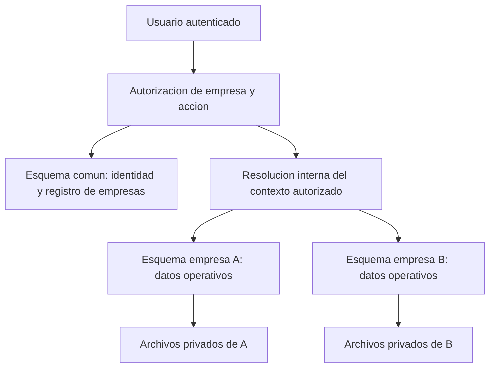
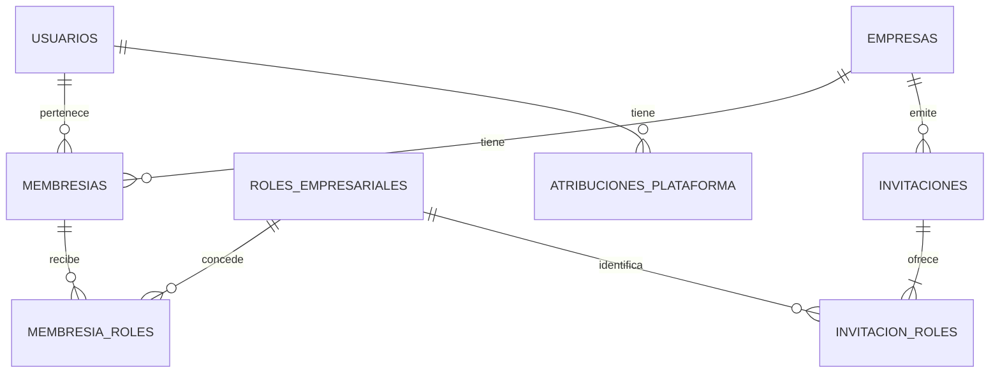
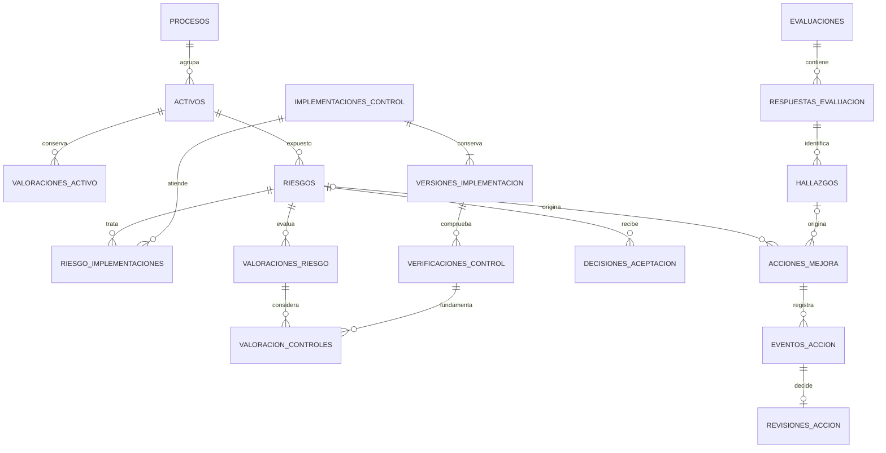

# Modelo de datos y aislamiento por esquemas

Versión: 0.4 — Coordinación con arquitectura y secuencia backend APR-08
Fecha: 6 de noviembre de 2026
Base: [Requerimientos y aprobaciones](01-parametros-y-requerimientos.md), [Permisos](02-matriz-de-permisos.md), [Casos de uso](03-casos-de-uso.md), [Cálculos](04-reglas-de-calculo-y-valoracion.md), [Diccionario](05-diccionario-de-datos-y-validaciones.md), [Estados](06-estados-y-transiciones.md).

## 1. Objetivo y estado de decisión

Definir entidades persistentes, claves, relaciones y controles para implementar la plataforma con esquema propio por empresa. APR-03 aprueba la distribución lógica y principios señalados en sección 14; nombres SQL y detalles físicos siguen por diseñar. No se crea base de datos ni se ejecutan migraciones en esta etapa.

Ya están aprobados: aplicación multiempresa con esquema empresarial separado; una membresía por usuario/empresa con varios roles; aislamiento de permisos, historial, criticidad por máximo, evaluación por control y residual categórico justificado sin descuentos automáticos (APR-01/APR-02). Esos acuerdos se conservan.

APR-03 aprueba PostgreSQL, distribución lógica, pertenencia, identidades técnicas, integridad y versiones. APR-04 aprueba DMP-04/DMP-07/DMP-08: referencias comunes y conexiones acotadas, alta/migraciones recuperables y archivos/recuperación inicial. Versión, SQL, configuración, extensiones, framework y límites siguen pendientes. Configurar y probar el aislamiento continúa siendo obligatorio; las aprobaciones no demuestran implementación. Las capacidades físicas se verificarán con documentación oficial de PostgreSQL antes de implementar.

## 2. Organización de ámbitos

El esquema común es compartido físicamente, no públicamente. Los usuarios empresariales no pueden listar identidades, sesiones, invitaciones o membresías de otras empresas. Los catálogos publicados pueden compartirse en lectura; respuestas, implementaciones y evidencias son privadas de cada empresa.

APR-03 aprueba una base relacional inicial PostgreSQL con esquema común y esquemas de empresa de identificadores internos generados. `comun`, `empresa_A` y `empresa_B` son nombres ilustrativos, no nombres físicos elegidos. El nombre visible de la empresa no se usa como nombre de esquema.

Los esquemas empresariales tienen la misma estructura y versión compatible; no se crean tablas diferentes para cada empresa. Personalización de metodologías empresariales continúa fuera de v1.

## 3. Convenciones del modelo lógico

- **PK:** clave primaria. APR-03 aprueba ID opaco generado por servidor; formato físico pendiente.
- **FK:** referencia que debe conservar integridad; no concede permiso para consultar el registro referenciado.
- **UQ:** combinación única. Un código de negocio no reemplaza la PK.
- Toda tabla persistente aplica autoría/fechas y revisión cuando corresponda según el diccionario. Una tabla de unión puede usar clave compuesta en lugar de un ID adicional, a decidir en el modelo físico.
- Datos empresariales locales se refieren entre sí dentro del mismo esquema; solo se permiten referencias explícitas al esquema común para identidad, membresía, catálogo y metodología. No se permiten referencias operativas a otro esquema empresarial.
- APR-03 aprueba incluir `empresa_id` en todas las tablas empresariales como redundancia controlada: deriva del contexto autorizado y coincide con la empresa propietaria; no es entrada libre del usuario.
- La información de una versión cerrada no se modifica en sitio. Campos derivados se calculan en servidor usando la metodología identificada y entradas de esa versión.
- Nombres lógicos, límites y códigos de tablas auxiliares no significan nuevas funcionalidades visibles en la aplicación.

## 4. Tablas propuestas en el esquema común

### 4.1. Identidad y autorización

| ID | Tabla lógica | Claves y relaciones | Finalidad y límite |
| --- | --- | --- | --- |
| MD-C01 | empresas | PK id; UQ esquema_interno | DD-01; registro interno, estado y versión técnica; sin secretos de acceso a BD |
| MD-C02 | usuarios | PK id; UQ clave_correo según normalización pendiente | DD-02; identidad única que puede tener varias membresías |
| MD-C03 | credenciales_usuario | PK/FK usuario_id → usuarios, si autenticación local | Separa hash de perfil; lectura solo por componente de identidad, nunca por roles empresariales |
| MD-C04 | membresias | PK id; FK empresa_id y usuario_id; UQ(empresa_id, usuario_id); UQ(empresa_id, id) | DD-03; conservar historial y membresías revocadas; asignación de tarea referencia membresía, no correo |
| MD-C05 | roles_empresariales | PK codigo con AE/GS/RA/AU | Catálogo cerrado; no contiene AP ni roles personalizados |
| MD-C06 | membresia_roles | PK(membresia_id, rol_codigo); FK a membresias y roles_empresariales | Relación muchos a muchos, sin duplicados; mínimo un rol si membresía activa |
| MD-C07 | atribuciones_plataforma | PK(usuario_id, codigo); FK usuario_id → usuarios | Atribución AP separada; sin concesión automática de contenido empresarial |
| MD-C08 | invitaciones | PK id; FK empresa_id; huella de comprobante, destinatario y fechas | DD-04; consumo/revocación/vencimiento; no guarda token en claro |
| MD-C09 | invitacion_roles | PK(invitacion_id, rol_codigo); FK a invitaciones y roles_empresariales | Conjunto ofrecido inmutable durante aceptación; inicial de AP ofrece AE |
| MD-C10 | sesiones | PK id; FK usuario_id → usuarios | DD-05; mecanismo y persistencia final dependen de autenticación; sin roles permanentes usados como autorización |
| MD-C11 | comprobantes_recuperacion | PK id; FK usuario_id → usuarios | DD-06; comprobante protegido de un solo uso; no contiene credencial recuperable |

Separar credenciales no exige un microservicio: se puede mantener una aplicación modular con accesos internos diferenciados. Perfiles y selectores no serializan hashes ni registros completos de identidad. No se elimina usuario mientras exista historia referenciada.

### 4.2. Catálogos, metodología y operación técnica

| ID | Tabla lógica | Claves y relaciones | Finalidad y límite |
| --- | --- | --- | --- |
| MD-C12 | catalogos | PK id; UQ codigo | Identidad del catálogo, DD-07 |
| MD-C13 | versiones_catalogo | PK id; FK catalogo_id; UQ(catalogo_id, version) | Edición publicada, consultable históricamente aunque deje de admitir usos nuevos |
| MD-C14 | elementos_catalogo | PK id; FK version_catalogo_id; UQ(version_catalogo_id, tipo, codigo); UQ(version_catalogo_id, id) | Control/cláusula y su grupo; una respuesta pertenece a la misma versión que la evaluación |
| MD-C15 | metodologias | PK id; UQ codigo | Identidad de la metodología, DD-08 |
| MD-C16 | versiones_metodologia | PK id; FK metodologia_id; UQ(metodologia_id, version) | Estado de aprobación, fundamento y definiciones inmutables publicadas; sin fórmulas ejecutables del usuario |
| MD-C17 | operaciones_aprovisionamiento | PK id; FK empresa_id; identificador de intento/idempotencia | Progreso de alta, pasos completados y fallo; no duplica empresa/esquema al reintentar |
| MD-C18 | historial_migraciones_empresa | PK id; FK empresa_id; referencia de migración y resultado | Distingue intento, aplicación y verificación de estructura; no confundir con metodología |
| MD-C19 | eventos_plataforma | PK id; actor de servicio/usuario y empresa opcional según evento | Cambios de plataforma/seguridad restringidos; no sustituyen historial operativo de empresa |
| MD-C20 | trabajos_sistema | PK id; FK empresa_id cuando el trabajo tenga ámbito empresarial | Contexto, finalidad, estado e idempotencia de tareas técnicas; sin contenido de evidencias o secretos en payload |

Las escalas, matriz y reglas declarativas se asocian a una versión de metodología; su representación como tablas auxiliares o estructura declarativa validada se decidirá en el modelo físico. Roles, relaciones de negocio y referencias principales no se guardan como cadenas separadas por comas.

Sesiones y recuperación son propuestas condicionadas al método de autenticación: si se usa un proveedor externo, se conserva solo la referencia y el estado local necesarios, sin replicar contraseñas del proveedor. Un trabajo técnico no autoriza correos, integraciones ni funciones diferidas que estén fuera del alcance funcional.

## 5. Tablas propuestas en cada esquema empresarial

### 5.1. Contexto, procesos y activos

| ID | Tabla lógica | Claves y relaciones | Finalidad |
| --- | --- | --- | --- |
| MD-E01 | contexto_empresa | Una fila propietaria; PK empresa_id → comun.empresas | Identifica empresa del esquema; solo aprovisionamiento puede fijar/cambiar estructura, no roles de ejecución |
| MD-E02 | responsables_negocio | PK id; empresa_id; membresia_id opcional | DD-10; persona/cargo/área; si hay cuenta vinculada, la membresía pertenece a la misma empresa |
| MD-E03 | procesos | PK id; empresa_id; FK responsable_negocio_id opcional | DD-09; activos/archivados; incluido_alcance solo si se aprueba DEC-12 |
| MD-E04 | activos | PK id; empresa_id; UQ(empresa_id, codigo_normalizado); FK proceso y propietario/custodio locales | DD-11; el código sigue reservado aunque se archive |
| MD-E05 | activo_tipos_dato | PK(activo_id, tipo_dato_codigo); empresa_id | Categorías de datos personales cuando aplican, sin duplicados |
| MD-E06 | valoraciones_activo | PK id; empresa_id; FK activo_id y version_metodologia_id | DD-12; entradas C/I/D, criticidad por máximo y confirmación; referencia vigente desde activo |

Principio de integridad aprobado APR-03: tablas locales vinculadas por empresa_id a contexto_empresa, cuya fila propietaria es única y no modificable por ejecución ordinaria. La restricción física se diseñará y probará con PostgreSQL; documentarla no demuestra aún que esté aplicada.

### 5.2. Evaluaciones y hallazgos

| ID | Tabla lógica | Claves y relaciones | Finalidad |
| --- | --- | --- | --- |
| MD-E07 | evaluaciones | PK id; empresa_id; FK versión de catálogo/metodología, responsable y evaluación anterior opcional | DD-13; corrección crea otra evaluación, no reabre original |
| MD-E08 | evaluacion_procesos | PK(evaluacion_id, proceso_id); empresa_id | Alcance estructurado; conserva los procesos seleccionados al evaluar |
| MD-E09 | respuestas_evaluacion | PK id; empresa_id; FK evaluación y elemento; UQ(evaluacion_id, elemento_id) | DD-14; fija conjunto de elementos desde inicio, aplicabilidad, nota, fundamento y confirmación heredada |
| MD-E10 | hallazgos | PK id; empresa_id; FK respuesta_id | DD-15; brecha/recomendación; historia ligada a evaluación cerrada |

Cada respuesta lleva referencia a la versión del catálogo de su evaluación. Se exige consistencia mediante claves compuestas o mecanismo equivalente verificable, no por comparar etiquetas en pantalla. El alcance incluye narrativa y relaciones de proceso; al cerrar se preserva una descripción histórica de lo evaluado, porque un proceso puede cambiar después.

La nota agregada no es una entrada de evaluación. Se calcula por controles aplicables evaluados, con igual peso individual, y cobertura separada. Los grupos de cláusulas se presentan separados y no se crea un global PHVA ponderado en v1. Si se conserva instantánea de cierre, contiene resultados y método reproducibles, no solo una cifra sin entradas.

### 5.3. Implementaciones, riesgos y valoraciones

| ID | Tabla lógica | Claves y relaciones | Finalidad |
| --- | --- | --- | --- |
| MD-E11 | implementaciones_control | PK id; empresa_id; FK elemento de catálogo y responsable local | DD-16; identidad de implementación y referencia a versión actual |
| MD-E12 | versiones_implementacion | PK id; empresa_id; FK implementacion_id; UQ(implementacion_id, numero_version) | Descripción/estado/modo/tipo/fechas que se consideraron en una valoración; no cambia la instantánea histórica |
| MD-E13 | verificaciones_control | PK id; empresa_id; FK version_implementacion_id | Conclusión, fundamento, evidencia, autor/fecha y revisión; implementación no equivale a efectividad |
| MD-E14 | riesgos | PK id; empresa_id; UQ(empresa_id, codigo_normalizado); FK activo principal, responsable y riesgo anterior opcional | DD-17; estado/tratamiento y referencias vigentes por clase de valoración |
| MD-E15 | riesgo_implementaciones | PK(riesgo_id, implementacion_id); empresa_id | DD-18; relación muchos a muchos, efecto esperado y justificación; conserva vínculos usados por históricos |
| MD-E16 | valoraciones_riesgo | PK id; empresa_id; FK riesgo, metodología y valoración inherente base opcional | DD-19; categorías elegidas, fundamento, nivel por matriz, equivalencias derivadas y confirmación |
| MD-E17 | valoracion_controles | PK(valoracion_id, verificacion_id); empresa_id | Verificaciones concretas consideradas; no un vínculo a «la última» que cambie retrospectivamente |
| MD-E18 | decisiones_aceptacion | PK id; empresa_id; FK riesgo y valoración de referencia | DD-20; aprobación AE, justificación y próxima revisión; no modifica índices ni cierra automáticamente |
| MD-E19 | avisos_revision_valoracion | PK id; empresa_id; FK valoración de activo o riesgo según tipo | Causa/fecha y resolución de revisión pendiente; no modifica la instantánea numérica |

La valoración residual guarda referencia a una inherente confirmada del mismo riesgo. Una verificación usada en residual debe corresponder a una implementación vinculada a ese riesgo en la misma empresa y a la versión considerada. No se introduce una columna de «descuento automático» ni se convierte nota de control en porcentaje de mitigación.

MD-E19 usa dos destinos tipados excluyentes (valoracion_activo_id o valoracion_riesgo_id) con integridad referencial, no un tipo/ID arbitrario sin FK. Un aviso puede resolverse mediante nueva valoración sin borrar el anterior; no sustituye el historial.

### 5.4. Acciones, evidencias e historial

| ID | Tabla lógica | Claves y relaciones | Finalidad |
| --- | --- | --- | --- |
| MD-E20 | acciones_mejora | PK id; empresa_id; UQ(empresa_id, codigo); FK riesgo o hallazgo, responsable y acción anterior opcional | DD-21; exactamente un origen; estado, plazo, criterio de entrega y contexto mínimo |
| MD-E21 | eventos_accion | PK id; empresa_id; FK accion_id, autor y membresía responsable al evento | DD-22; avances y solicitud de revisión; no editar silenciosamente entregas |
| MD-E22 | revisiones_accion | PK id; empresa_id; FK entrega_id → eventos_accion; UQ entrega_id | DD-22; aprobar/devolver una entrega una sola vez; revisor distinto del usuario responsable de esa entrega |
| MD-E23 | evidencias | PK id; empresa_id; modalidad y destino tipado | DD-23; archivo privado o referencia verificable; metadatos de disponibilidad, no prueba automática de suficiencia |
| MD-E24 | accion_evidencias_contexto | PK(accion_id, evidencia_id); empresa_id | DD-24; selección explícita de documentos de contexto para RA, con motivo y autor |
| MD-E25 | entrega_evidencias | PK(entrega_id, evidencia_id); empresa_id | Fija qué evidencia acompañaba a la solicitud de revisión; una carga posterior no altera esa entrega |
| MD-E26 | verificacion_evidencias | PK(verificacion_id, evidencia_id); empresa_id | Fija evidencias de una comprobación sin depender solo de archivos actuales de implementación |
| MD-E27 | eventos_actividad | PK id; empresa_id; actor, objeto y correlación | DD-25; historial empresarial, solo sistema escribe y solo AE consulta registro administrativo |

Propuesta de destino de MD-E23: tres FK opcionales a respuesta_evaluacion, implementacion_control o accion_mejora, exactamente una no nula. MD-E25/MD-E26 pueden relacionar evidencias autorizadas del contexto correspondiente, sin cambiar su propietario ni conceder navegación adicional. Una evidencia de control usada como contexto de acción requiere autorización explícita; no basta incluir su ID en una entrega.

Eventos administrativos pueden conservar tipo/ID histórico con acceso restringido; no se usan para establecer relaciones de negocio ni navegar automáticamente a un registro sin autorización. Referencias de negocio sí requieren FK tipadas. No se presupone una tabla por cada estado o por cada pantalla.

## 6. Diagramas de relaciones principales

### 6.1. Identidad común y roles

El diagrama permite cero asignaciones de rol por membresía para representar registros revocados/históricos; la condición adicional es mínimo un rol mientras activa. Invitación emitida exige conjunto ofrecido no vacío. AP no forma parte de ROLES_EMPRESARIALES.

### 6.2. Núcleo empresarial

Los dos orígenes de acción son excluyentes, aunque el diagrama por sí solo no expresa esa condición. Solo eventos de tipo solicitud de revisión pueden ser entrega_id. Ninguna relación de este diagrama atraviesa dos empresas; los catálogos y autores comunes están omitidos para legibilidad.

## 7. Integridad y referencias a datos comunes

| ID | Regla lógica | Refuerzo requerido |
| --- | --- | --- |
| MOD-01 | La empresa local coincide con la fila propietaria del esquema | Restricción de fila única, FK local y permisos que impidan modificar propietario con credencial ordinaria |
| MOD-02 | Referencia local pertenece al mismo esquema y empresa | FK explícita a tabla local; incluir empresa en claves compuestas cuando sea necesaria para demostrar pertenencia |
| MOD-03 | Responsable de acción/evaluación usa membresía de la empresa | FK(empresa_id, membresia_id) → comun.membresias(empresa_id,id) o equivalente verificable; servidor comprueba vigencia y roles en operación |
| MOD-04 | Autor histórico identifica persona real sin exigir membresía vigente para leer historia | FK a usuario o actor técnico tipado; conservar membresía/roles al evento como instantánea de atribución, no permiso actual |
| MOD-05 | Respuesta y elemento usan la versión de catálogo de evaluación | Claves compuestas/validación atómica, conjunto de elementos fijo; no mezclar ediciones por compartir código |
| MOD-06 | Base inherente, residual y aceptación se refieren al mismo riesgo | Relaciones compuestas que incorporen riesgo/empresa y comprobación de clase/confirmación vigente |
| MOD-07 | Las versiones vigentes pertenecen al objeto y están confirmadas | Puntero vigente con FK de pertenencia y validación de confirmación; actualizarlo en la misma operación |
| MOD-08 | Exactamente un origen de acción y un destino de evidencia | Exclusión de nulos con FK tipadas; no simples ID arbitrarios |
| MOD-09 | Códigos y relaciones no se duplican | UQ locales y tablas de unión; normalización definida antes del modelo físico |
| MOD-10 | Membresía activa tiene roles y empresa conserva AE activo | Transacción coordinada por empresa y validación de conjunto final; no basta una validación de formulario |
| MOD-11 | Una entrega recibe una decisión y el revisor no es su responsable | UQ entrega_id, pertenencia a acción, estado esperado y comprobación de identidad al confirmar |
| MOD-12 | Datos confirmados/cerrados y versiones publicadas no se reescriben | Separar borrador/confirmación; permisos y estrategia de persistencia inmutable a definir; no solo un booleano de interfaz |

Una FK a membresía preserva integridad, pero no prueba que siga activa ni que tenga el rol requerido. Se valida siempre autorización actual; una referencia histórica revocada permanece legible según permisos del consultante. Una FK al usuario común tampoco autoriza mostrar sus otras membresías o datos de autenticación.

Se propone denegar cascadas destructivas desde empresas, usuarios, activos o catálogos hacia registros de negocio. Archivar mantiene claves y vínculos. No hay eliminación empresarial/retención física hasta aprobar la política correspondiente.

## 8. Contrato de aislamiento por operación

Se propone el siguiente flujo obligatorio en servidor, independiente de la forma de las URLs:

1. Recibir identificador de empresa, recurso y acción como datos no confiables. El nombre del esquema no es un parámetro de API.
2. Verificar sesión/cuenta, empresa activa, membresía y conjunto de roles vigentes. Resolver el permiso efectivo como concesiones locales sujetas a restricciones de estado, objeto e identidad.
3. Resolver empresa_id → esquema/credencial de ejecución mediante registro interno autorizado. No construir identificadores con nombre de empresa, código de activo o texto del usuario. La vinculación a secretos ocurre fuera de los datos expuestos.
4. Obtener conexión dedicada al contexto validado, iniciar unidad de trabajo y verificar propietario/versión compatibles. Consultas empresariales utilizan nombres de tabla resueltos a ese esquema; valores se pasan como parámetros y los identificadores solo proceden del registro interno con tratamiento seguro del motor elegido.
5. Resolver el recurso dentro del contexto; no buscar primero su ID en todas las empresas para después decidir permiso. Validar referencias locales y permisos específicos, incluido responsable/revisor.
6. Para cambios, comprobar revisión esperada y reglas de transición; revalidar condiciones sensibles al confirmar. Guardar negocio e historial atómicamente cuando residan en la misma base.
7. Finalizar, limpiar estado de conexión y devolver solo proyección autorizada. Ante error, revertir y descartar la conexión si no se puede garantizar contexto limpio.

Cada solicitud conserva su empresa explícita; no se usa una variable global de «empresa actual». Un cambio de pestaña no modifica operaciones ya preparadas en otra empresa. Reportes, filtros y descargas siguen el mismo contrato.

### 8.1. Protección de base de datos: principio aprobado, configuración pendiente

APR-03 aprueba **una identidad técnica de ejecución limitada a cada esquema empresarial**; APR-04 confirma conexiones separadas de identidad común y acceso común mínimo. La configuración física se concreta antes de implementar; la separación no se basa solo en cambiar contexto con una credencial capaz de leer todo.

| Identidad/componente técnico | Puede | No puede |
| --- | --- | --- |
| Ejecución empresa A | Operar tablas autorizadas de A y lectura mínima publicada de catálogos | Leer/escribir B, cambiar propietario del esquema, crear tablas o gestionar usuarios técnicos |
| Identidad/registro común | Autenticar, resolver membresías y administrar invitaciones mediante operaciones limitadas | Exponer listados globales a usuarios empresariales o conceder permisos basándose en entrada del cliente |
| Aprovisionamiento/migración | Crear/verificar esquemas y aplicar cambios versionados | Ser credencial ordinaria de las solicitudes de negocio |
| Respaldo/restauración | Acceso técnico definido para copias y recuperación | Usarse desde formularios, reportes o tareas de usuarios |

Los roles AE/GS/RA/AU son de aplicación, no credenciales de BD por persona. La identidad técnica de empresa no decide si un usuario es auditor o gestor; esa autorización sigue en servidor. Una conexión A debe recibir rechazo de base al intentar consultar B aunque el recurso sea conocido.

No se usará una credencial de negocio universal que cambie libremente de rol como único control de separación. Cualquier cambio a ese principio requiere revisión explícita y prueba de rechazo equivalente. Motor ya elegido: PostgreSQL. Permisos concretos, operaciones comunes, secretos y conexiones aún requieren diseño con DMP-04; DMP-03 está aprobada como principio, no implementada.

Esto limita errores y exposición de una conexión empresarial, pero no promete aislamiento frente a un administrador de infraestructura o compromiso total del servidor que controla todas las credenciales. El acceso de esos operadores y la protección del almacén de secretos requieren medidas operativas separadas. AP no recibe esos privilegios por tener un rol en la aplicación.

### 8.2. Conexiones y simultaneidad

Principios de DMP-04 aprobados en APR-04: comprobar empresa en referencias de membresía; separar conexión común de identidad y ejecución empresarial; reutilizar solo en contexto autorizado, con límites; autorización vigente por operación y lectura mínima común. No concede acceso al directorio global. Falta elegir permisos, control de conexiones y límites físicos.

- Agrupar/reutilizar conexiones por identidad técnica y empresa; nunca entregar una conexión de A al contexto B sin una estrategia demostrablemente segura. Limitar conexiones y expulsar grupos inactivos según capacidad, sin mantener un grupo ilimitado por empresa.
- Ni un error ni una cancelación dejan una transacción, rol, contexto temporal o resultado preparado de A disponible a otra empresa. Si se usan nombres de tabla sin calificar, la configuración deberá probarse; preferencia propuesta por destinos explícitos resueltos internamente.
- Coordinar alta/retirada de roles sobre la empresa y registrar conjunto final de permisos. Dos retiros simultáneos no pueden dejar sin AE; dos consumos de invitación no crean membresías duplicadas.
- Definir en arquitectura cómo una revocación concurrente se coordina con una operación ya en curso. El requisito mínimo vigente es que ninguna solicitud posterior a la revocación pueda usar la autorización anterior; no se presume cancelación de información ya entregada.

## 9. Historial, versiones y resultados derivados

Se propone mantener registros editables en borrador y nuevas versiones al confirmar cambios, con referencias explícitas a la versión vigente. Para controles se separa identidad de implementación, versión y verificación. Para acciones se separa entrega y decisión; para riesgos se conserva inherente base y conjunto de verificaciones consideradas.

Al cerrar una evaluación, congelar alcance, respuestas, referencias de catálogo/metodología y resultados reproducibles. La corrección crea otra evaluación relacionada; no se cambia la instantánea anterior. Una nueva versión de metodología no reinterpreta silenciosamente una valoración confirmada.

Los avisos de revisión son eventos separados: pueden afectar vigencia sin editar la calificación o nivel histórico. Valoración nueva confirmada mueve el puntero vigente con validación de pertenencia; una aún en borrador no reemplaza la última confirmada, aunque puede existir aviso de que la anterior necesita revisión.

Para reproducir un reporte histórico no basta guardar «nombre de activo» actual o «último control»: conservar referencias inmutables o instantánea contextual acotada de los datos relevantes al cierre. No duplicar expedientes completos en logs. El grado exacto de instantánea se decide en DMP-06.

Se propone calcular paneles/reportes desde datos autorizados; no guardar tablas duplicadas de totales inicialmente. Si luego se necesita caché, la clave incluye empresa, filtros, versiones e identidad/alcance de autorización según vista; la respuesta revalida acceso. No compartir resultados de RA con un gestor ni entre empresas por coincidir filtros.

## 10. Evidencias, referencias y trabajos fuera de la solicitud

Los archivos no se almacenan como rutas públicas en los registros. Claves privadas se generan por empresa y evidencia; el navegador no elige destino. La descarga revalida acceso al objeto y para RA la asignación/contexto autorizado. Los enlaces temporales, si se incorporan, tienen vigencia limitada y forman parte del diseño técnico pendiente.

Una referencia documental guarda identificador, versión/fecha y localizador. El servidor no sigue enlaces externos automáticamente ni guarda credenciales en la referencia. Disponible significa que el registro está completo técnicamente, no que el documento haya sido verificado como suficiente para una conclusión.

Base de datos y almacenamiento privado no se consideran una única transacción. Reservar evidencia pendiente, completar/validar archivo o referencia y marcar disponible solo tras revalidar contexto. Si falla la publicación, no cuenta como evidencia de cierre. La compensación elimina únicamente objetos temporales del intento autorizado conforme una política técnica, nunca evidencias disponibles por una ruta enviada por cliente.

Un trabajo empresarial conserva empresa, finalidad, objeto, versión esperada y correlación. Si actúa por un usuario, revalida sus permisos al ejecutarse y antes de publicar resultado; si usa identidad de servicio, su permiso y finalidad están especificados y no le conceden exportación global. La suspensión bloquea publicaciones empresariales. Una credencial de migración no se reutiliza para generar reportes o descargar archivos.

## 11. Alta, migraciones y recuperación

### 11.1. Alta de empresa

Principio aprobado APR-04: reservar empresa/identificador; aprovisionar esquema/fila propietaria, identidad técnica y estructura; verificar relaciones/permisos/configuración; preparar invitación recuperable según canal elegido y activar solo al concluir requisitos. Registrar pasos/errores y reintentar sobre la misma empresa sin duplicación; fallo mantiene acceso operativo bloqueado.

El mecanismo de emisión/entrega de invitación y la condición técnica final de activación aún deben resolverse con EST-01, sin marcar una entrega de correo como exitosa si solo se generó un token.

### 11.2. Migraciones

Mantener historial por empresa/migración, versión objetivo, intento y resultado. APR-04 aprueba procesar una empresa a la vez en v1, bloquear operaciones incompatibles durante cambio/fallo y probar antes en entorno separado. No se requiere interfaz avanzada inicial. Mantenimiento/recuperación concreta se diseña técnicamente, no como nuevo estado empresarial sin actualizar diccionario.

No declarar versión instalada antes de verificarla. Ante fallo, bloquear operaciones incompatibles de esa empresa y conservar datos/fallo para recuperación; otras empresas compatibles pueden seguir operando. No afirmar que todo cambio de estructura es reversible transaccionalmente: la estrategia depende del motor y de la migración. Probar primero en copia y definir restauración o reparación antes de ejecución real.

### 11.3. Respaldo y restauración

Un esquema empresarial depende de identidades, catálogos y metodologías comunes, además de archivos. Copiar solo sus tablas no garantiza una restauración consistente. La copia debe registrar versión, punto de referencia, dependencias y manifiesto de archivos; concretar mecanismo de coherencia con arquitectura.

APR-04 aprueba demostrar restauración completa en entorno separado, con base común, esquemas y archivos coordinados, sin sustituir datos activos. Respaldos diarios, pérdida máxima 24 horas y recuperación 8 horas siguen como metas propuestas pendientes de infraestructura, no garantías aprobadas.

Restaurar solo una empresa requiere comprobar identidades/membresías y versiones comunes, sin sobrescribir otras empresas ni reactivar accesos revocados. APR-04 aprueba diferir esa capacidad hasta diseñarla/probarla, manteniendo separación desde inicio. No implica exportación o portabilidad completa en v1.

## 12. Escenarios de verificación de aislamiento y modelo

Estos escenarios serán pruebas de implementación futuras. En esta etapa se verifica la coherencia documental, no una base de datos en ejecución.

| ID | Escenario | Resultado esperado |
| --- | --- | --- |
| AIS-01 | Usuario de A solicita ID válido de activo/riesgo/evidencia de B | Denegación sin buscar/revelar contenido de B |
| AIS-02 | Conexión técnica de A intenta consultar o escribir B | Rechazo del motor por permisos, además de autorización de aplicación |
| AIS-03 | Se introduce empresa_id=B en una fila del esquema A | Rechazo por propietario local/integridad; cliente no controla empresa_id |
| AIS-04 | Acción de A referencia membresía o activo de B | Rechazo de pertenencia; una FK de ID sin empresa no basta |
| AIS-05 | Usuario AE+GS en A y AU en B intenta editar B | Denegación sin mezcla de roles |
| AIS-06 | Usuario GS+RA intenta aprobar su entrega | Rechazo por identidad aunque su conexión pueda escribir registros locales |
| AIS-07 | Dos retiros de últimos AE ocurren simultáneamente | Se conserva al menos una membresía activa que incluya AE |
| AIS-08 | Dos aceptaciones de un comprobante | Una membresía, un consumo, sin rol añadido por manipulación |
| AIS-09 | Fallo de consulta de A seguido de solicitud de B | Contextos limpios; sin filas, rol técnico o transacción residual de A |
| AIS-10 | Respuesta usa un elemento de otra versión del catálogo | Rechazo; evaluación y respuesta comparten versión |
| AIS-11 | Residual referencia inherente de otro riesgo o verificación no vinculada | Rechazo de relación, aun si pertenece a la misma empresa |
| AIS-12 | Se publica nueva versión de catálogo/implementación/metodología | Históricos siguen referenciando versiones originales |
| AIS-13 | Dos revisores deciden una entrega | Una decisión y estado coherente; el segundo recibe conflicto |
| AIS-14 | Se reordena contexto de evidencia de una tarea en revisión | Entrega congelada y referencias originales intactas |
| AIS-15 | RA descarga archivo por ruta o ID conocido sin autorización | Rechazo, aunque comparta prefijo de empresa |
| AIS-16 | Trabajo o reporte se ejecuta después de revocación/suspensión | Sin publicación con permiso anterior; no mezcla datos de otras empresas |
| AIS-17 | Aprovisionamiento falla y se reintenta | Misma empresa/esquema, sin activación parcial ni privilegios excesivos |
| AIS-18 | Migración falla en A mientras B es compatible | No se marca A compatible; B no pierde aislamiento ni sus datos |
| AIS-19 | Restauración completa en entorno separado | Relaciones, versiones y archivos recuperables sin modificar entorno activo |
| AIS-20 | Caché recibe filtros iguales de A y B o usuarios con acceso distinto | Resultados separados y acceso revalidado |
| AIS-21 | Se borra activo/catálogo/usuario con historia referenciada | No hay cascada destructiva; flujos ordinarios conservan referencias |
| AIS-22 | Referencia documental pretende introducir credenciales o descargar externo automáticamente | No ejecutar recuperación automática; validar referencia y proteger contenido |

## 13. Correspondencia con el diccionario y los flujos

| Datos | Modelo lógico | Flujos/restricciones |
| --- | --- | --- |
| DD-01/DD-02 | MD-C01 a MD-C03 | CU-01 a CU-04; privilegios de plataforma separados |
| DD-03/DD-04 | MD-C04 a MD-C09 | CU-05/CU-07/CU-08; APR-01 |
| DD-05/DD-06 | MD-C10/MD-C11 | CU-03/CU-04; consumo y vencimiento |
| DD-07/DD-08 | MD-C12 a MD-C16 | CU-13; catálogo/metodología versionados |
| Soporte técnico de DD-01 | MD-C17 a MD-C20 | TR-EMP, migraciones e historial técnico restringido |
| DD-09/DD-10/DD-11/DD-12 | MD-E01 a MD-E06 | CU-09 a CU-12; máximo C/I/D de APR-02 |
| DD-13/DD-14/DD-15 | MD-E07 a MD-E10 | CU-14 a CU-16; peso por control, PHVA diferido |
| DD-16/DD-17/DD-18/DD-19/DD-20 | MD-E11 a MD-E19 | CU-17 a CU-21; residual categórico sin descuentos |
| DD-21/DD-22 | MD-E20 a MD-E22 y MD-E25 | CU-22 a CU-24; revisión por otra persona |
| DD-23/DD-24 | MD-E23/MD-E24/MD-E25/MD-E26 | CU-25; archivo privado o referencia según criterio |
| DD-25 | MD-E27 | CU-28; historial inmutable desde interfaz |
| DD-26 | Consultas/vistas derivadas, sin tabla de reporte obligatoria | CU-26/CU-27; permisos y empresa en cada operación |

Las 26 entidades conceptuales tienen correspondencia, pero no necesariamente una tabla por entidad: roles, versiones, decisiones y relaciones necesitan separación para integridad. Los mecanismos aplican SEG-01 a SEG-10, DVAL-01 a DVAL-15 y las transiciones TR del documento 6 según ámbito.

## 14. Estado de decisiones tras APR-03 y APR-04

El usuario aprobó DMP-01/02/03/05/06 en APR-03 y DMP-04/07/08 en APR-04, el 6 de noviembre de 2026 en el chat. Registros y alcance en documento 1. Las ocho decisiones están aprobadas en principios de diseño, sin aprobar automáticamente cifras o mecanismos físicos aún no definidos.

| ID | Decisión nueva o pendiente | Recomendación para el proyecto | Estado |
| --- | --- | --- | --- |
| DMP-01 | Motor y arquitectura inicial de base | PostgreSQL, base inicial con esquema común y uno por empresa | Aprobada APR-03; versión/configuración pendientes |
| DMP-02 | Distribución lógica y marca de pertenencia | Tablas comunes/empresariales, empresa_id local y fila propietaria | Aprobada APR-03; representación física por definir |
| DMP-03 | Barrera de permisos en base de datos | Identidad técnica limitada por empresa, separada de identidad común y aprovisionamiento; rechazo A→B también en motor | Aprobada APR-03; concretar/probar permisos junto con DMP-04 antes de implementar |
| DMP-04 | Relaciones al esquema común y conexiones | Referencias con empresa para membresías, acceso común mínimo, conexiones separadas/acotadas y autorización por operación | Aprobada APR-04; permisos y límites concretos pendientes de diseño físico |
| DMP-05 | Claves e integridad | ID opaco, tablas de unión para roles, códigos únicos locales y sin cascadas destructivas | Aprobada APR-03; formato/normalización pendientes |
| DMP-06 | Persistencia de versiones y evidencia de decisiones | Separar versión/verificación, entrega/revisión y avisos; referencias inmutables e instantánea mínima al cierre | Aprobada APR-03; detalle físico pendiente |
| DMP-07 | Alta, migraciones y trabajos técnicos | Pasos/errores y reintentos sin duplicación; activación verificada; migraciones secuenciales por empresa con bloqueo/prueba previa | Aprobada APR-04; canal y mecanismos concretos de recuperación pendientes |
| DMP-08 | Recuperación inicial y archivos | Archivos privados por empresa; copias coordinadas y restauración completa aislada; restauración selectiva diferida | Aprobada APR-04; cuotas, retención y metas operativas aún pendientes |

Siguiente etapa: arquitectura/diseño físico y configuración de PostgreSQL, autenticación, conexiones, archivos y recuperación. No se vuelve a solicitar aprobación de los ocho principios DMP; las decisiones nuevas y valores operativos sí deben concretarse. Ninguna aprobación significa SQL ejecutado o pruebas de aislamiento/restauración realizadas.

## 15. Detalles técnicos y funcionales todavía abiertos

- Versión/configuración de PostgreSQL, formato de ID, tipos numéricos, timestamps, normalización y longitudes, índices físicos y concurrencia. El motor ya está aprobado.
- Mecanismo de identidad local/proveedor y políticas de contraseñas, duración de sesiones, invitaciones y recuperación. APR-07 del documento 08 ya aprueba sesión de servidor con cookie protegida y CSRF; no se reabre ese principio ni se emiten tokens reales mediante este documento.
- Mecanismo exacto de permisos por esquema, operaciones mínimas de identidad común, almacén de secretos, conexiones y acceso de infraestructura.
- Publicación/aprobación de metodología, rúbricas por categoría, evidencia por criterio, madurez agregada y vigencia de verificaciones.
- Catálogos de versiones de controles (DEC-11) y cobertura de procesos (DEC-12); NIST independiente y ponderación PHVA siguen diferidos.
- Retención, cuotas, corrección de archivos, procedimiento de retiro empresarial y coherencia de copias de base/almacenamiento.
- Estrategia de reparación de migraciones, readmisión de membresías y desactivación de asociaciones para futuros análisis sin modificar historia.

La arquitectura está desarrollada en el [documento 08](08-arquitectura-y-decisiones-tecnicas.md). El diseño físico/SQL requiere seleccionar versión y concretar los mecanismos aprobados de PostgreSQL. Migraciones y recuperación requieren procedimientos operativos verificables antes de ejecutarse en entorno de uso. Este archivo no implementa ni demuestra aislamiento en ejecución.

## 16. Coordinación de implementación con APR-08

El acuerdo APR-08 del documento 08 ratifica DMP-01 a DMP-04 y DMP-07 y sitúa las migraciones y la demostración de aislamiento después del diagnóstico y estructura modular, antes de ampliar funcionalidades. Deben prepararse dos empresas ficticias, accesos común/empresariales separados y credenciales de migración distintas de las ordinarias; comprobar rechazo entre esquemas en el motor y ausencia de mezcla de conexiones/contextos. Al integrar sesión y permisos se verifica además la autorización empresarial por solicitud y la revocación efectiva.

La recuperación de altas y migraciones fallidas debe contemplarse desde el inicio, con reintentos sobre la misma empresa y sin activación parcial. Los escenarios AIS de la sección 12 de este documento y AT de la sección 14 del [documento 08](08-arquitectura-y-decisiones-tecnicas.md) se incorporan a las pruebas según el alcance de cada entrega; no se declaran superados por esta aprobación. Las ocho decisiones DMP conservan el alcance aprobado y sus detalles físicos pendientes, sin nuevas cifras ni políticas operativas.
