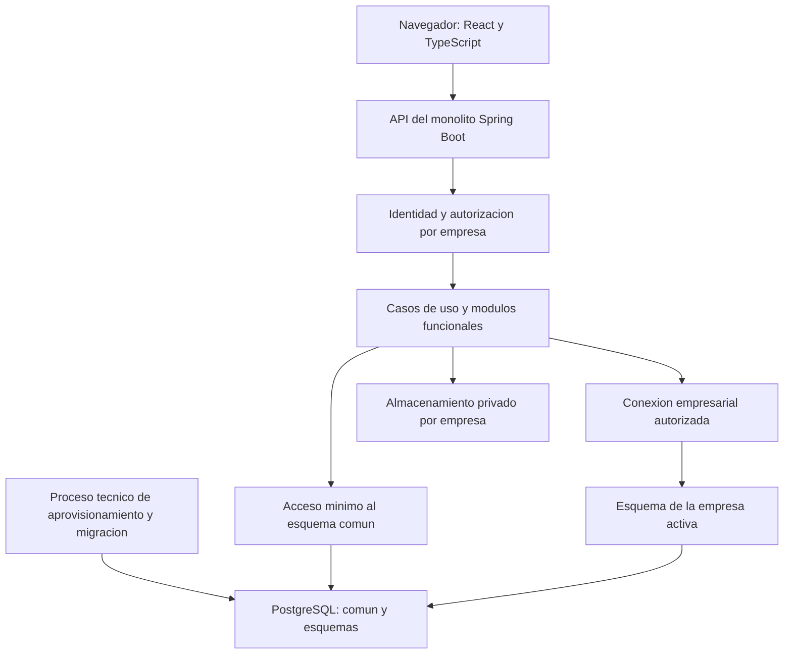

# Arquitectura y decisiones técnicas

Versión: 0.4 — Principios ARQ-09 a ARQ-14 y bibliotecas frontend aprobados
Fecha: 6 de noviembre de 2026
Relacionados: [Requerimientos y aprobaciones](01-parametros-y-requerimientos.md), [Permisos](02-matriz-de-permisos.md), [Casos de uso](03-casos-de-uso.md), [Cálculos](04-reglas-de-calculo-y-valoracion.md), [Diccionario](05-diccionario-de-datos-y-validaciones.md), [Estados](06-estados-y-transiciones.md), [Modelo y aislamiento](07-modelo-de-datos-y-aislamiento-por-esquemas.md).

## 1. Alcance de este documento

Definir la arquitectura inicial del sistema y registrar las tecnologías indicadas por el usuario: backend Spring Boot organizado como monolito modular, frontend React + TypeScript + Vite y repositorios independientes de documentación, backend y frontend.

El backend utiliza Maven, Java 17 y Spring Boot 4.1.2, con grupo `software`, artefacto `mspi` y paquete base `software.mspi`. El frontend utiliza React, TypeScript y Vite. Ambos proyectos mantienen su código en la rama `Develop` de sus respectivos repositorios.

La arquitectura establece responsabilidades, contratos, límites de módulos y criterios de seguridad y operación. Los diagramas y estructuras describen el diseño del sistema; su implementación y verificación se desarrollan en los repositorios de código.

Convenciones: **confirmado** = decisión del proyecto o configuración comprobada; **heredado** = aprobado en APR-01 a APR-04; **aprobado** = decisión aceptada con alcance explícito; **propuesto** = alternativa pendiente de revisión; **por verificar** = comprobación técnica aún no realizada. La presencia de dependencias no demuestra compilación ni aislamiento en ejecución.

## 2. Registro de decisiones confirmadas APR-05

APR-05 registra las tecnologías y organización definidas por el usuario el 6 de noviembre de 2026. APR-06 (sección 17) aprueba modularidad/persistencia y APR-07 (sección 18) aprueba los principios técnicos restantes y cinco bibliotecas frontend. Los parámetros todavía no definidos conservan su estado pendiente.

| ID | Decisión | Estado y origen |
| --- | --- | --- |
| ARQ-01 | Spring Boot como backend y monolito modular para v1 | Confirmado por instrucción del usuario |
| ARQ-02 | Maven, Java 17, Spring Boot 4.1.2, Jar, YAML | Configuración del proyecto; Java/Boot/Maven comprobados en POM; compilación y entorno pendientes |
| ARQ-03 | Group `software`, Artifact `mspi`, paquete base `software.mspi` | Metadatos definidos; groupId/artifactId comprobados en POM |
| ARQ-04 | React + TypeScript + Vite como frontend | Confirmado por instrucción del usuario; versiones concretas no elegidas |
| ARQ-05 | Repositorios separados; código backend/frontend en Develop | Remotos aportados por usuario y rama comprobada en ambos; enlaces en sección 4; rutas locales no verificadas |
| ARQ-06 | PostgreSQL, esquemas por empresa, identidad técnica limitada y aislamiento | Heredado de APR-03/APR-04; versión y mecanismos físicos pendientes |

Java 17 es la selección de esta versión del proyecto, reemplazando la sugerencia conversacional de Java 21, que no había sido aprobada. La documentación de Boot 4.1.2 establece Java 17 como mínimo compatible; esa compatibilidad no sustituye la comprobación de otras bibliotecas. [Requisitos oficiales de Spring Boot](https://docs.spring.io/spring-boot/system-requirements.html).

APR-07 aprueba Material UI, React Router, React Hook Form, Zod y TanStack Query, además de autenticación web mediante sesión/cookie y CSRF. Versiones compatibles, biblioteca de gráficos, proveedor de alojamiento y parámetros operativos aún deben definirse.

## 3. Vista general



El backend es una aplicación desplegable y un límite inicial de operación. El frontend se construye de forma independiente y consume su API. Repositorios separados no implican microservicios ni exigen dominios web distintos.

Se propone una interfaz web de tipo SPA para los flujos autenticados. No se introduce un segundo backend de negocio en el frontend. Vite sirve como herramienta de desarrollo/construcción; el servidor de desarrollo no se plantea como servidor de producción. React documenta Vite y su plantilla TypeScript como una vía de construcción, dejando por resolver navegación y acceso a datos. [Guía oficial de React](https://react.dev/learn/build-a-react-app-from-scratch).

Los módulos separan funciones; los esquemas separan empresas. Todos los módulos operativos trabajan sobre la misma empresa autorizada de la unidad de trabajo. No se crea un módulo Java distinto por empresa ni un esquema nuevo por cada módulo.

## 4. Repositorios, ramas y trazabilidad

| Componente | Repositorio remoto para Git | Rama actual de código | Enlace de consulta |
| --- | --- | --- | --- |
| Backend | [Software_MSPI-back.git](https://github.com/jose6668/Software_MSPI-back.git) | `Develop` | [Código backend en Develop](https://github.com/jose6668/Software_MSPI-back/tree/Develop) |
| Frontend | [Software_MSPI-front.git](https://github.com/jose6668/Software_MSPI-front.git) | `Develop` | [Código frontend en Develop](https://github.com/jose6668/Software_MSPI-front/tree/Develop) |

Se respeta exactamente la mayúscula inicial de `Develop`, sin asumir que sea la rama predeterminada o de despliegue. Las revisiones de configuración indican rama y commit para permitir reproducibilidad.

Configuración backend comprobada el 6 de noviembre de 2026: [mspi/pom.xml](https://github.com/jose6668/Software_MSPI-back/blob/01afba1397bdbe821dec79102a1ef8947511bc9d/mspi/pom.xml), commit `01afba1397bdbe821dec79102a1ef8947511bc9d`, blob `b6aeff6e69c09dcc442d5896bcb972ab1c2af029`. La raíz Maven está en `mspi/`, no en la raíz del repositorio. Esta revisión se limita al manifiesto; no incluye compilación, pruebas o auditoría completa. El manifiesto frontend y las rutas locales siguen pendientes de revisión.

| Repositorio | Responsabilidad | Información compartida por contrato |
| --- | --- | --- |
| Documentación | Requerimientos, decisiones, modelo, arquitectura y criterios de aceptación | Identificadores RF, CU, PER, CAL, TR, DMP y ARQ |
| Backend | Aplicación Spring Boot, módulos, persistencia, migraciones y pruebas, cuando se implementen | API, códigos de error, políticas de versión y permisos |
| Frontend | Aplicación React, componentes, formularios, navegación y pruebas, cuando se implementen | Contratos API y representación de estados/permisos |

Propuesta: relacionar cambios de código con requisitos/casos de uso y registrar qué versión de API soporta cada entrega de frontend. Evitar copiar reglas de negocio en tres lugares: backend calcula y valida; frontend presenta y orienta; documentación explica la versión acordada.

No almacenar secretos en ninguno de los repositorios. Los enlaces de código quedan registrados aquí sin trasladar código al repositorio documental. `Develop` es la ubicación actual indicada por el usuario, no una aprobación implícita de GitFlow, despliegues automáticos o permisos de publicación. Protecciones de rama, revisiones y política de integración siguen pendientes. No se realiza clone, checkout, commit o push mediante esta actualización.

## 5. Dependencias del backend

### 5.1. Dependencias declaradas en el backend

| Dependencia o integración | Uso en la arquitectura | Estado comprobado |
| --- | --- | --- |
| Spring Web MVC | API REST del monolito | `spring-boot-starter-webmvc` declarado |
| Spring Data JPA | Repositorios y persistencia aprobada en ARQ-08 | `spring-boot-starter-data-jpa` declarado |
| Spring Security | Autenticación y autorización | `spring-boot-starter-security` declarado; mecanismo de sesión/proveedor pendiente |
| Validation | Validación de entradas | `spring-boot-starter-validation` declarado; no sustituye integridad/autorización |
| PostgreSQL Driver | Conexiones PostgreSQL | `org.postgresql:postgresql`, alcance runtime |
| Flyway | Cambios de estructura | Starter Flyway y `flyway-database-postgresql` declarados |
| Actuator | Salud y observación operativa | Starter Actuator declarado; exposición aún por configurar |
| Spring Modulith 2.1.1 | Estructura, pruebas e integración modular | BOM 2.1.1; starters core/JPA y componentes runtime, observabilidad y Actuator declarados |
| Pruebas | Soporte de pruebas de los componentes | Starters de pruebas de Actuator/JPA/Flyway/Security/Validation/Web MVC y Modulith declarados |

Las declaraciones anteriores se comprobaron en el POM del commit indicado. Falta verificar resolución de dependencias, compilación, ejecución y configuración multiesquema. El starter JPA de Modulith no resuelve por sí mismo dónde persistir eventos de varias empresas; esa decisión permanece en ARQ-13.

### 5.2. Decisiones de integración y componentes pendientes

| Componente | Recomendación | Estado |
| --- | --- | --- |
| Spring MVC | Contratos, validaciones y manejo de errores REST | Dependencia presente; contrato ARQ-10 pendiente |
| Spring Data JPA | Aislamiento de identidad común y contexto empresarial | Uso aprobado ARQ-08; diseño físico y prueba técnica pendientes |
| Flyway para PostgreSQL | Ejecución técnica separada por ámbito y permisos | Dependencias presentes; ejecución/recuperación ARQ-13 pendiente |
| Pruebas de módulos | Comprobar límites mediante Spring Modulith | Dependencia de pruebas presente; pruebas aún no ejecutadas |
| Pruebas de integración | Pruebas de seguridad, API y PostgreSQL real mediante Testcontainers | Propuesto; versiones y ejecución a definir |
| Documentación API | Contrato OpenAPI compatible con Boot 4 | Aprobado APR-07; biblioteca/integración y versión pendientes |

Boot publica starters y gestión de versiones para su plataforma; se propone respetar sus versiones gestionadas y comprobar el BOM generado para Modulith en lugar de mezclar versiones manualmente. [Dependencias de Spring Boot](https://docs.spring.io/spring-boot/reference/using/build-systems.html). Spring documenta el módulo específico de Flyway para PostgreSQL y recomienda una estrategia única de inicialización. [Inicialización y migraciones](https://docs.spring.io/spring-boot/how-to/data-initialization.html).

Lombok, MapStruct, Redis, Kafka, RabbitMQ, Spring Cloud y librerías JWT no se consideran seleccionadas ni necesarias por el hecho de usar un monolito modular. Se incorporarán únicamente con una necesidad concreta y revisión de compatibilidad. No se instala nada mediante este documento.

## 6. Diseño del monolito modular

Se propone organizar por capacidad funcional, no poner todos los controladores, servicios y repositorios de la aplicación en carpetas globales.

| Módulo aprobado bajo software.mspi | Responsabilidad principal | Propiedad lógica de datos |
| --- | --- | --- |
| identidad | Cuenta, autenticación, sesión y recuperación | Usuarios, credenciales, sesiones y comprobantes comunes |
| empresas | Registro, membresías, roles e invitaciones | Empresas y autorización empresarial común |
| catalogos | Catálogos y metodologías versionadas | Versiones publicadas y definiciones comunes |
| activos | Procesos, responsables, inventario y clasificación | Datos y valoraciones de activos empresariales |
| evaluaciones | Evaluaciones, respuestas y hallazgos | Diagnósticos empresariales y correcciones vinculadas |
| controles | Implementaciones, versiones y verificaciones | Aplicación empresarial de controles |
| riesgos | Registro, valoraciones y aceptación del riesgo | Riesgos, asociaciones y valoraciones categóricas |
| acciones | Tareas, entregas y revisiones independientes | Acciones y decisiones de revisión |
| evidencias | Archivo privado o referencia documental | Metadatos, carga y acceso técnico a evidencias |
| auditoria | Atribución y registro restringido de eventos | Historial empresarial y adaptador de eventos técnicos separados por ámbito |
| reportes | Vistas de consulta y reporte básico | Proyecciones autorizadas; no nuevas fuentes de verdad |
| gestion | Coordinación de casos de uso que cruzan módulos | Orquestación; no duplicación de entidades o repositorios ajenos |

ARQ-07 aprueba estos doce límites funcionales y gestion como coordinador. Su presencia efectiva en el código debe implementarse y verificarse. Aprovisionamiento, conexiones, almacenamiento y migraciones son adaptadores técnicos con acceso controlado; una utilidad global no puede convertirse en puerta para consultar cualquier empresa.

### 6.1. Estructura interior propuesta

Representación documental de ejemplo:

```text
software.mspi.activos
  api          contratos públicos para otros módulos
  internal
    web        entrada HTTP y DTO de ese módulo
    application casos de uso y límites transaccionales
    domain     reglas del módulo
    persistence adaptadores y repositorios internos
```

Los nombres internos y exposición de paquetes se ajustarán al modelo de Spring Modulith. Los tipos internos no son API pública por ser clases Java public. ARQ-07 aprueba un proyecto Maven inicial, módulos lógicos por paquetes y un Jar; no se exigen módulos Maven separados por dominio en v1.

### 6.2. Reglas de dependencia

- Cada módulo posee sus datos y escrituras. Otro módulo usa su contrato público, no importa repositorio o entidad JPA interna.
- Intercambiar identificadores y DTO específicos; evitar asociaciones ORM entre entidades internas de módulos diferentes que provoquen navegación/escritura implícita.
- Conservar FK de integridad del monolito cuando corresponda al modelo aprobado. La FK no autoriza que todos los módulos consulten esa tabla directamente.
- Reglas C/I/D, notas y categorías se aplican en servicios del backend con versión de metodología; el frontend no suministra un resultado definitivo ya calculado.
- Evitar dependencias circulares. Operaciones transversales se coordinan en gestion o mediante eventos con consumidores explícitos.
- Auditoría de decisiones y cambios obligatorios no se entrega solo como evento volátil que pueda perderse después del cambio de negocio.

Spring Modulith permite verificar ciclos, accesos a paquetes internos y dependencias permitidas. Se propone ejecutar esas comprobaciones como parte de las pruebas del backend. No se ha ejecutado esa verificación sobre el repositorio externo en esta tarea. [Verificación oficial](https://docs.spring.io/spring-modulith/reference/verification.html).

### 6.3. Evitar ciclos concretos del proyecto

| Caso transversal | Coordinación propuesta | Dependencia que se evita |
| --- | --- | --- |
| Crear acción desde riesgo o hallazgo | gestion verifica origen mediante API de riesgos/evaluaciones y solicita alta a acciones | acciones y riesgos consultándose repositorios mutuamente |
| Cerrar riesgo sin tareas abiertas | gestion consulta estado de acciones y solicita transición de riesgos con las precondiciones verificadas en la unidad de trabajo | riesgos dependiendo de acciones mientras acciones depende de riesgos |
| Adjuntar evidencia a tarea/evaluación/control | gestion comprueba autorización/estado del destino, llama evidencias y vincula mediante contratos públicos | evidencias importando todos los dominios y todos importando su implementación |
| Cambia verificación de control | Contrato/evento explícito coordinado marca revisión de valoraciones afectadas | controles escribiendo directamente en tablas internas de riesgos |
| Reporte por empresa | reportes consume proyecciones públicas y contexto autorizado | Acceso universal sin permisos a repositorios y esquemas |

El coordinador no recibe autoridad ilimitada: cada comando conserva empresa, identidad, acción y revisión esperada y los módulos revalidan sus invariantes. La consistencia entre validar precondiciones y guardar transición debe garantizarse con control de concurrencia; un DTO «validado» del navegador no sirve como comprobación.

## 7. Acceso a datos y transacciones

Se conserva DMP-03/DMP-04: identidad técnica limitada por empresa, acceso común mínimo, contexto explícito y rechazo A→B también en el motor.

Flujo propuesto:

1. Spring Security establece identidad autenticada; el caso de uso recibe empresa solicitada como dato no confiable.
2. Consultar estado empresarial, membresía y roles vigentes por el acceso común autorizado.
3. Resolver internamente la conexión de empresa; no aceptar nombres de esquema, credenciales o destino JDBC desde el navegador.
4. Abrir unidad de trabajo fijada a esa empresa e identidad técnica, verificar pertenencia/versión y ejecutar módulo/caso de uso.
5. Validar revisión, objeto, asignación e identidad de revisor; guardar cambio e historial obligatorio.
6. Confirmar o revertir y cerrar/limpiar contexto. Los errores no dejan una conexión utilizable por otra empresa.

La conexión común de identidad y la empresarial no se consideran automáticamente una sola transacción por anotar un método. Los casos que escriben en ámbitos distintos deben tener una estrategia explícita de consistencia y recuperación. Las operaciones empresariales que necesiten atomicidad entre módulos deben compartir la misma unidad de trabajo/conexión empresarial, no abrir una transacción independiente por módulo sin control.

### JPA: decisión aprobada y verificación técnica pendiente

ARQ-08 aprueba Spring Data JPA como persistencia. Su implementación debe demostrar selección de conexión por empresa, separación de identidad común, fijación del contexto durante la transacción y ausencia de contaminación de cachés/contexto de persistencia. La aprobación no autoriza un DataSource global con acceso universal. No iniciar consultas diferidas fuera del contexto autorizado ni cambiar empresa dentro de la misma unidad de trabajo.

No se prescribe un EntityManagerFactory ilimitado por empresa ni un usuario SQL que lea todos los esquemas. El mecanismo JPA debe ser compatible con credenciales empresariales limitadas; su configuración requiere prueba técnica en el backend. Si no satisface las restricciones, documentar y revisar una alternativa JDBC antes de sustituir la decisión, sin cambiar silenciosamente ARQ-08 o DMP-03.

Propuesta inicial: sin caché compartida de entidades empresariales ni totales hasta demostrar su separación. Las claves de caché del frontend/consultas deben incluir empresa y alcance de autorización, no solo ID del objeto.

## 8. API y comunicación con frontend

APR-07 aprueba API REST con JSON, prefijo `/api/v1` y empresa explícita validada en rutas empresariales; archivos usan flujo separado. Los siguientes ejemplos ilustran esa convención, no endpoints implementados. Contratos concretos por operación siguen por especificar:

```text
/api/v1/identidad/...
/api/v1/mis-empresas
/api/v1/empresas/{empresaId}/activos/...
/api/v1/empresas/{empresaId}/evaluaciones/...
/api/v1/empresas/{empresaId}/riesgos/...
/api/v1/empresas/{empresaId}/acciones/...
```

- empresaId selecciona contexto que siempre se valida; no se vuelve autorización por aparecer en la URL.
- DTO de entrada acepta solo campos permitidos. Autor, empresa efectiva, privilegios y resultados se obtienen en servidor.
- Listas paginadas con filtros/ordenación permitidos; no aceptar expresiones SQL o nombres de esquema.
- Errores con código estable, mensaje, campos y correlación cuando corresponda, sin SQL, rutas privadas o secretos. Conflictos de edición se distinguen de errores de campos.
- Operaciones de aprobación/cierre son comandos explícitos; no permitir saltos de estado modificando libremente un campo estado.
- Un identificador de correlación une backend/historial sin duplicar contenidos sensibles.
- Contrato debe incluir nulabilidad, unidades, fechas/zonas, precisión de presentación y estados provisionales. Las equivalencias de riesgo no se publican como probabilidades medidas.

APR-07 aprueba DTO separados de entidades JPA, paginación/filtros permitidos, errores uniformes, revisión esperada y comandos de transición explícitos. El contrato se documentará mediante OpenAPI; respuestas/códigos HTTP, formatos e integración compatible todavía deben especificarse. No se genera contrato ni cliente en esta actualización.

## 9. Autenticación y autorización

APR-07 aprueba Spring Security con sesión de servidor y cookie de sesión `HttpOnly`, `Secure` bajo HTTPS, manteniendo protección CSRF. Se aprueba el objetivo de frontend/API bajo el mismo origen externo cuando el alojamiento lo permita. No se introduce JWT como mecanismo inicial. Duraciones, política de credenciales, atributos de cookie dependientes del despliegue, invitaciones y recuperación siguen por concretar.

Proteger cookie de sesión conforme al entorno, HTTPS fuera de desarrollo, cierre/invalidación en servidor y tratamiento explícito del token CSRF en el cliente. La cookie de sesión y el token CSRF tienen funciones distintas; no exponer el identificador de sesión a JavaScript para resolver CSRF. No desactivar esa protección por usar React. [Guía de Spring Security](https://docs.spring.io/spring-security/reference/servlet/exploits/csrf.html).

Alternativas como proveedor OIDC o tokens se revisarán si surge necesidad; JWT no es obligatorio por tener React o repositorios separados. No almacenar secretos de base de datos en el navegador y no tratar comprobantes accesibles a JavaScript como almacenamiento seguro por defecto.

Autorización heredada:

- Una membresía por usuario/empresa, uno o varios roles empresariales; concesiones combinadas solo localmente.
- AP no recibe lectura empresarial automática. AU sin otros roles no edita; AU+GS sí puede recibir edición por GS.
- Responsable de tarea no aprueba su propia entrega, aunque sea AE/GS y acumule roles.
- Revocaciones y cambios se consideran en solicitudes posteriores. No congelar permisos empresariales dentro de un token o caché sin estrategia de invalidación verificable.
- Menús/rutas ocultos mejoran interfaz, pero el servidor protege cada operación y descarga.

Si desarrollo usa orígenes separados para Vite/API, configurar una lista explícita de orígenes permitidos y credenciales según el mecanismo elegido. La política CORS no sustituye autorización ni aislamiento.

## 10. Organización del frontend

React + TypeScript + Vite están confirmados; las siguientes convenciones son propuestas:

```text
src/
  app/          inicio, proveedores y rutas
  features/     acceso, empresas, activos, evaluaciones, riesgos y acciones
  shared/       componentes visuales, cliente HTTP y utilidades pequeñas
```

Cada funcionalidad agrupa páginas, componentes, tipos, formularios y acceso API. Evitar duplicar entidades de base de datos en tipos frontend: definir contratos de pantalla/API y distinguir campos editables de derivados.

Comportamientos requeridos por decisiones anteriores:

- Mostrar empresa activa y roles efectivos. Al cambiar empresa limpiar datos/formularios o advertir cambios pendientes; conservar contexto explícito de solicitudes ya emitidas.
- Separar cachés por empresa. No mostrar una respuesta tardía de A sobre pantalla de B ni conservar datos empresariales al cerrar sesión.
- Representar pendiente, N justificado, cero y puntaje provisional de forma distinta; notas individuales discretas y dos decimales en agregados.
- Presentar controles y cláusulas separados; sin global PHVA ponderado en v1.
- Seleccionar categorías de probabilidad/impacto y justificar residual; no enviar descuentos por calificación de control.
- Dar a RA su vista mínima cuando solo tenga ese rol y permitir permisos adicionales únicamente cuando otro rol los conceda.
- Validar formularios para orientar, conservando servidor como autoridad. No adjuntar archivo nuevo a una entrega congelada.

### Bibliotecas del frontend aprobadas y pendientes acotados

| Necesidad | Elección | Estado |
| --- | --- | --- |
| Navegación | React Router | Aprobada APR-07; modo/configuración de rutas por definir |
| Formularios | React Hook Form | Aprobada APR-07; organización de formularios por funcionalidad |
| Validación tipada | Zod | Aprobada APR-07; esquemas frontend no reemplazan validación del backend |
| Consultas/caché | TanStack Query | Aprobada APR-07; claves por empresa y alcance, invalidación y limpieza al cerrar sesión |
| Interfaz visual | Material UI | Aprobada APR-07; componentes y tema por definir |
| Gráficos | Matriz de riesgos y resúmenes accesibles | Pendiente; no generar visualizaciones nuevas en esta tarea |
| Versiones/runtime | React, TypeScript, Vite, Node y gestor de paquetes compatibles | Pendiente de fijar en repositorio frontend y comprobar requisitos oficiales |

Las cinco bibliotecas se instalan/configuran en el repositorio frontend en una etapa posterior. Fuentes de referencia: [React Router](https://reactrouter.com/start/declarative/installation), [React Hook Form](https://react-hook-form.com/get-started), [Zod](https://zod.dev/), [TanStack Query](https://tanstack.com/query/latest/docs/framework/react/overview) y [Material UI](https://mui.com/material-ui/getting-started/). La aprobación elige herramientas, no versiones ni una configuración ya probada.

Al cambiar empresa, separar cachés y descartar respuestas tardías del contexto anterior. Al cerrar sesión, limpiar datos privados del cliente. Las reglas y resultados definitivos siguen en servidor; no duplicar el cálculo de criticidad o residual como autoridad en los formularios.

## 11. Flyway y ciclo técnico de empresa

APR-07 aprueba Flyway como único mecanismo de evolución de estructura, con credenciales técnicas separadas conforme DMP-07. Distinguir ámbito común y migraciones empresariales con historial por empresa/esquema y verificación antes de habilitar operaciones. Organización exacta y ejecución quedan por configurar.

La aplicación ordinaria no autoaprovisiona esquemas al arrancar con credencial universal de migración. Un proceso técnico controlado aplica cambios/registra intentos. Las dependencias están comprobadas en POM; configuración de ejecución y recuperación aún debe concretarse y probarse.

Con JPA aprobado, Hibernate no creará ni actualizará tablas automáticamente como segundo mecanismo. La validación de estructura se configurará por ámbito sin suponer que una conexión prueba todos los esquemas. [Inicialización de bases](https://docs.spring.io/spring-boot/how-to/data-initialization.html).

APR-07 aprueba coordinación síncrona mediante contratos públicos para operaciones críticas iniciales y sin broker en v1. Cambio obligatorio de negocio e historial debe conservar consistencia transaccional; un evento volátil no reemplaza esa garantía. Antes de introducir asincronía necesaria se definirán publicación fiable, persistencia, reintentos e idempotencia. El starter de eventos de Modulith no configura ni habilita automáticamente ese diseño.

Alta: reservar empresa, crear estructura/propietario y permisos, verificar compatibilidad, preparar invitación por canal elegido y activar solo al completar requisitos. Reintentos no duplican empresa; migraciones empresariales inicialmente secuenciales y con bloqueo de operaciones incompatibles. No hay recuperación demostrada hasta ejecutar pruebas en entorno separado.

## 12. Archivos, operación y despliegue

DMP-08 aprobado: archivo privado por empresa, metadatos en BD, descarga autorizada y copias coordinadas. Proveedor, carpetas físicas, cuotas y retención siguen pendientes. Una referencia documental no concede acceso externo ni se descarga automáticamente.

APR-07 aprueba entornos separados de desarrollo y demostración, almacenamiento privado y el objetivo de frontend/API bajo un mismo origen cuando sea viable. Se propone una instancia backend y frontend estático inicialmente; proveedor, contenedores, dominios, puertos y proxy siguen por elegir. Repositorios separados no obligan a desplegar módulos backend por separado.

Se aprueba integración continua para compilación/pruebas en ambos repositorios y pruebas de integración backend con PostgreSQL real mediante Testcontainers, incluyendo aislamiento, permisos y concurrencia. La biblioteca permite administrar servicios en contenedores durante pruebas; su ejecución necesita un entorno compatible, por concretar. [Integración oficial de Testcontainers](https://docs.spring.io/spring-boot/reference/testing/testcontainers.html). No se crean workflows ni se ejecutan esas pruebas en esta actualización.

Configuraciones por entorno y secretos externos al repositorio; YAML no almacena credenciales reales versionadas. Actuator expone solo comprobaciones acordadas a destinatarios autorizados; no publicar configuración, conexiones o información interna de empresas.

Registros técnicos con correlación y datos mínimos, sin contraseñas/tokens/documentos. Historial empresarial de negocio se conserva separado y consultable por AE según permisos. Salud del proceso no demuestra que todas las empresas tengan esquema compatible.

Respaldos diarios, pérdida máxima de 24 horas y recuperación en 8 horas siguen como metas propuestas, no cifras aprobadas por seleccionar este stack. Restauración completa en entorno separado antes de datos reales; recuperación selectiva empresarial diferida.

## 13. Preparación para una eventual extracción a microservicios

El monolito modular es una decisión inicial, no una promesa de migración automática. Para facilitar una posible extracción se propone mantener propiedad de datos, contratos públicos, límites sin ciclos y cambios versionados.

En v1 se permiten FK y transacciones locales del modelo aprobado. Extraer un módulo puede exigir reemplazar FK entre servicios, dividir transacciones, migrar datos, introducir contratos remotos y gestionar consistencia eventual. No asumir que basta mover carpetas o activar un broker.

Eventos internos relevantes deberán transportar empresa, identificador, versión y correlación mínimos; no enviar entidades ORM completas ni secretos. Antes de procesamiento asíncrono duradero definir publicación fiable, reintentos e idempotencia por empresa. Seleccionar Spring Modulith no aprueba automáticamente su registro de eventos persistentes, ni dónde almacenarlo en un sistema multiesquema; requiere decisión específica.

No se incorporan en esta versión microservicios, descubrimiento de servicios, API Gateway o brokers únicamente para anticipar una migración hipotética. Se evaluará extraer cuando exista un motivo operativo o de dominio concreto.

## 14. Verificación prevista

Escenarios futuros; no se han ejecutado compilación o pruebas de código. La lectura remota del POM de referencia sí está registrada en sección 4; no equivale a auditoría completa ni ejecución.

| ID | Comprobación | Resultado esperado |
| --- | --- | --- |
| AT-01 | Compilar backend real con Java 17 y Boot 4.1.2 | Dependencias compatibles y compilación reproducible; lectura de POM no sustituye ejecución |
| AT-02 | Verificar estructura con Spring Modulith | Sin ciclos ni accesos a componentes internos no autorizados |
| AT-03 | Conexión A consulta B y solicitud con ID ajeno | Rechazo en motor y servidor, respectivamente |
| AT-04 | Mezclar caché/contexto JPA o cambiar empresa en una transacción | Bloqueo de cambio/mezcla; ningún dato de otra empresa |
| AT-05 | Usuario GS+RA intenta aprobar su entrega | Denegación por identidad |
| AT-06 | Revocar membresía con sesión/consulta abierta | Nuevas solicitudes no usan permisos antiguos |
| AT-07 | Cambiar empresa mientras responde consulta frontend anterior | No mostrar respuesta de otra empresa; caché y estado segregados |
| AT-08 | Dos revisores o dos consumos del mismo comprobante | Una decisión/consumo, sin duplicación |
| AT-09 | Migrar con fallo y reintentar alta | Sin activación parcial ni privilegios ordinarios de DDL |
| AT-10 | Aplicar reglas de APR-02 | Máximo C/I/D, notas discretas, promedio por control y residual sin descuentos automáticos |
| AT-11 | Fallo entre archivo privado y publicación en BD | Evidencia no disponible, sin cierre basado en carga parcial |
| AT-12 | Restaurar entorno completo | BD común, esquemas, versiones y archivos coherentes, sin modificar entorno activo |
| AT-13 | Contrato backend/frontend y cambio de versión | Campos/errores/estados compatibles; no presentar pendientes como cero |
| AT-14 | Autenticación web elegida y solicitudes de modificación | Controles de sesión/CSRF/origen coherentes con diseño aprobado |

## 15. Estado de decisiones técnicas

ARQ-01 a ARQ-06 están confirmadas. APR-06 aprueba ARQ-07/ARQ-08 y APR-07 aprueba los principios recomendados de ARQ-09 a ARQ-14. Quedan por definir los detalles físicos, versiones y políticas que se indican en cada fila; no se considera implementación verificada:

| ID | Tema | Estado y trabajo restante |
| --- | --- | --- |
| ARQ-07 | Límites de módulos | Aprobada APR-06: doce módulos, gestion coordinador, un proyecto Maven y un Jar, contratos públicos e internos encapsulados |
| ARQ-08 | Persistencia | Aprobada APR-06: Spring Data JPA, presente en POM; configuración y prueba de aislamiento por credencial/contexto pendientes |
| ARQ-09 | Autenticación web | Aprobada APR-07: sesión de servidor, cookie protegida y CSRF; duraciones/credenciales/canales por definir |
| ARQ-10 | API | Aprobada APR-07: REST /api/v1, DTO, empresa validada, paginación, errores, revisión y comandos; OpenAPI aprobado, integración y contratos específicos pendientes |
| ARQ-11 | Bibliotecas frontend | Aprobada APR-07: React Router, React Hook Form, Zod, TanStack Query y Material UI; versiones/runtime, gráficos y tema pendientes |
| ARQ-12 | Conexiones y PostgreSQL | Aprobada APR-07: accesos separados, credencial/pool acotados por empresa, contexto fijo y secretos externos; versión/permisos/límites físicos y prueba con dos empresas pendientes |
| ARQ-13 | Migraciones y eventos | Aprobada APR-07: Flyway único con credencial separada, sin DDL automático de Hibernate, coordinación síncrona inicial y sin broker; recuperación/asincronía fiable por concretar cuando aplique |
| ARQ-14 | Infraestructura y pruebas | Aprobada APR-07: entornos separados, origen común cuando viable, archivos privados, CI y pruebas PostgreSQL con Testcontainers; proveedor, cuotas, retención y metas operativas pendientes |

Adicionalmente siguen abiertos los pendientes funcionales ya registrados: rúbricas de riesgo/evidencia, umbrales agregados, política de cláusulas, retención y readmisión. Redactar arquitectura no completa decisiones funcionales inexistentes.

## 16. Trazabilidad y fuentes

| Diseño | Referencias del proyecto |
| --- | --- |
| Modularidad, propiedad e historial | APR-01/APR-02; DMP-05/DMP-06; DD-01 a DD-26 |
| Identidad, empresas y autorización | PER-01 a PER-38; CU-01 a CU-08; PA del documento 2 |
| Acceso empresarial y transacciones | SEG-01 a SEG-10; DMP-01 a DMP-04; MOD y AIS del documento 7 |
| Funciones y cálculos | RF-06 a RF-20; CAL del documento 4; CU-09 a CU-27 |
| Estados y evidencia | TR del documento 6; DVAL del documento 5; DMP-08 |
| Operación y recuperación | RNF del documento 1; DMP-07/DMP-08; AIS/AT para pruebas futuras |

Las fuentes oficiales se enlazan junto a las afirmaciones técnicas y fueron consultadas el 6 de noviembre de 2026. Las propuestas de diseño son decisiones del proyecto, no prescripciones de las bibliotecas. Modulith 2.1.1 está declarado por el POM de referencia; su ejecución y compatibilidad del conjunto se comprobarán mediante pruebas. [Módulos de Spring Modulith](https://docs.spring.io/spring-modulith/reference/appendix.html).

Siguiente etapa: detallar contratos y configuración de los principios aprobados y ejecutar verificaciones de modularidad/aislamiento. El POM backend está revisado; manifiesto frontend, versiones compatibles, código funcional, compilación y pruebas siguen por verificar. Las decisiones no requieren nueva aprobación del mismo principio; sus parámetros todavía no definidos se revisarán explícitamente.

## 17. Registro de aprobación APR-06

Fecha: 6 de noviembre de 2026. El usuario aprueba las dos decisiones recomendadas como siguientes pasos: ARQ-07 y ARQ-08.

- **ARQ-07:** doce módulos funcionales de la sección 6, incluyendo gestion para coordinación transversal; monolito con un proyecto Maven y un Jar inicialmente, contratos públicos y encapsulación de internos, sin dependencias circulares. La distribución no equivale a paquetes ya implementados.
- **ARQ-08:** Spring Data JPA como persistencia, conservando separación de identidad común y empresa, credenciales empresariales limitadas y contexto fijado por transacción. Antes de uso real se debe demostrar aislamiento de conexiones/cachés, integridad y autorización. No se aprueba acceso universal ni se declara una prueba técnica superada.

La revisión del POM confirma dependencias, no implementación. Estado histórico de APR-06: ARQ-09 a ARQ-14 quedaron pendientes. Su aprobación posterior está en APR-07; no se atribuye a APR-06 elección de autenticación, bibliotecas frontend, límites o proveedor.

## 18. Registro de aprobación APR-07

Fecha: 6 de noviembre de 2026. El usuario aprueba las recomendaciones para ARQ-09 a ARQ-14 y solicita actualizar este documento.

- **ARQ-09:** sesión de servidor con cookie de sesión HttpOnly, Secure en HTTPS y CSRF, invalidación en servidor y permisos vigentes por operación; sin JWT inicial. Duraciones y políticas específicas aún abiertas.
- **ARQ-10:** API REST /api/v1, empresa explícita validada, DTO separados de entidades, paginación/filtros permitidos, errores uniformes, revisión esperada, transiciones por comandos y contrato OpenAPI. Faltan contratos detallados e integración concreta.
- **ARQ-11:** React Router, React Hook Form, Zod, TanStack Query y Material UI. Claves de consultas separadas por empresa/alcance y limpieza de datos privados al salir. Versiones compatibles, biblioteca de gráficos y parámetros visuales no elegidos.
- **ARQ-12:** separación de acceso común/empresarial, credencial limitada por empresa, conexiones acotadas, empresa fija durante transacción y secretos fuera del repositorio. Demostrar aislamiento con dos empresas antes de extenderlo; versión PostgreSQL, límites y configuración final pendientes.
- **ARQ-13:** Flyway como único mecanismo de evolución, credenciales técnicas separadas y sin creación/actualización automática Hibernate; contratos y coordinación síncrona para operaciones críticas, sin broker inicialmente. Asincronía futura requiere fiabilidad, persistencia e idempotencia explícitas.
- **ARQ-14:** desarrollo/demostración separados, objetivo de origen común cuando viable, almacenamiento privado, integración continua en ambos repositorios y pruebas con PostgreSQL real mediante Testcontainers.

Esta aprobación no fija proveedor, costes, cuotas, retención, tiempos de sesión/invitación/recuperación, tamaño de pools, versiones frontend/PostgreSQL o metas de recuperación. No instala dependencias, modifica código o workflows, ni acredita pruebas ejecutadas. El registro y los cambios se limitan a este Markdown.
