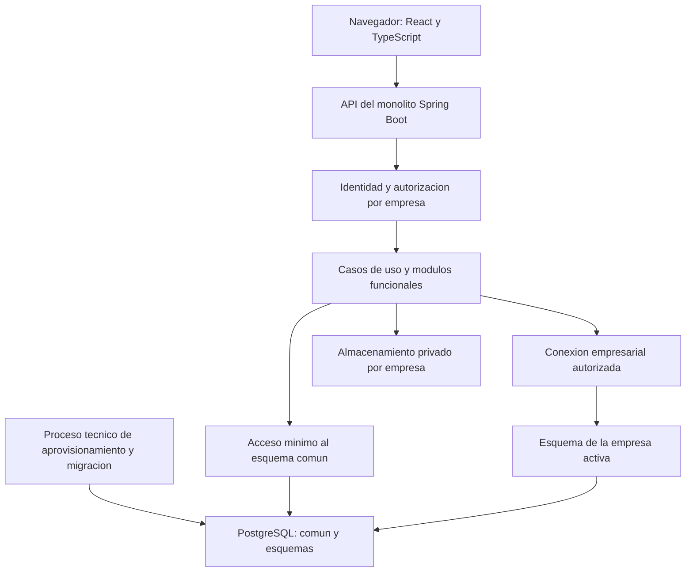

# Arquitectura y decisiones técnicas

Versión: 0.2 — Repositorios y rama Develop registrados y comprobados
Fecha: 6 de noviembre de 2026
Relacionados: [Requerimientos y aprobaciones](01-parametros-y-requerimientos.md), [Permisos](02-matriz-de-permisos.md), [Casos de uso](03-casos-de-uso.md), [Cálculos](04-reglas-de-calculo-y-valoracion.md), [Diccionario](05-diccionario-de-datos-y-validaciones.md), [Estados](06-estados-y-transiciones.md), [Modelo y aislamiento](07-modelo-de-datos-y-aislamiento-por-esquemas.md).

## 1. Alcance de este documento

Definir la arquitectura inicial del sistema y registrar las tecnologías indicadas por el usuario: backend Spring Boot organizado como monolito modular, frontend React + TypeScript + Vite y repositorios independientes de documentación, backend y frontend.

La configuración del backend se documenta a partir de la captura de Spring Initializr, no de inspección del POM o compilación. El usuario proporcionó los remotos del backend y frontend y señaló que el código está en `Develop` en ambos; la existencia de esa rama se comprobó mediante la conexión GitHub el 6 de noviembre de 2026. Las rutas locales de esos repositorios siguen sin verificarse y no se inventan.

Esta actualización modifica solamente este Markdown. No se crean ni modifican código, POM, scripts, configuraciones, dependencias, ramas o infraestructura. Los árboles, rutas de API y diagramas siguientes son diseños escritos, no archivos generados. El README y los documentos anteriores se conservan sin cambios.

Convenciones: **confirmado** = indicado por usuario o visible en la captura; **heredado** = aprobado en APR-01 a APR-04; **propuesto** = recomendación técnica aún por revisar; **por verificar** = requiere inspección del proyecto real. Confirmar una selección en Initializr no demuestra que el proyecto compile o tenga aislamiento implementado.

## 2. Registro de decisiones confirmadas APR-05

Se registra APR-05 en este documento, sin modificar el registro histórico del documento 1 por el alcance de archivo único solicitado. Fecha: 6 de noviembre de 2026. Fundamento: instrucciones del usuario y captura suministrada.

| ID | Decisión | Estado y origen |
| --- | --- | --- |
| ARQ-01 | Spring Boot como backend y monolito modular para v1 | Confirmado por instrucción del usuario |
| ARQ-02 | Maven, Java 17, Spring Boot 4.1.2, Jar, YAML | Confirmado en captura; verificar después compilación y entorno instalado |
| ARQ-03 | Group `software`, Artifact `mspi`, paquete base `software.mspi` | Confirmado en captura; se respeta sin sustituirlo por la sugerencia anterior |
| ARQ-04 | React + TypeScript + Vite como frontend | Confirmado por instrucción del usuario; versiones concretas no elegidas |
| ARQ-05 | Repositorios separados; código backend/frontend en Develop | Remotos aportados por usuario y rama comprobada en ambos; enlaces en sección 4; rutas locales no verificadas |
| ARQ-06 | PostgreSQL, esquemas por empresa, identidad técnica limitada y aislamiento | Heredado de APR-03/APR-04; versión y mecanismos físicos pendientes |

Java 17 es la selección de esta versión del proyecto, reemplazando la sugerencia conversacional de Java 21, que no había sido aprobada. La documentación de Boot 4.1.2 establece Java 17 como mínimo compatible; esa compatibilidad no sustituye la comprobación de otras bibliotecas. [Requisitos oficiales de Spring Boot](https://docs.spring.io/spring-boot/system-requirements.html).

Material UI no se considera elegida por escoger React. Biblioteca visual, rutas, formularios, consultas, autenticación y alojamiento siguen como decisiones técnicas pendientes.

## 3. Vista general



El backend es una aplicación desplegable y un límite inicial de operación. El frontend se construye de forma independiente y consume su API. Repositorios separados no implican microservicios ni exigen dominios web distintos.

Se propone una interfaz web de tipo SPA para los flujos autenticados. No se introduce un segundo backend de negocio en el frontend. Vite sirve como herramienta de desarrollo/construcción; el servidor de desarrollo no se plantea como servidor de producción. React documenta Vite y su plantilla TypeScript como una vía de construcción, dejando por resolver navegación y acceso a datos. [Guía oficial de React](https://react.dev/learn/build-a-react-app-from-scratch).

Los módulos separan funciones; los esquemas separan empresas. Todos los módulos operativos trabajan sobre la misma empresa autorizada de la unidad de trabajo. No se crea un módulo Java distinto por empresa ni un esquema nuevo por cada módulo.

## 4. Repositorios, ramas y trazabilidad

| Componente | Repositorio remoto para Git | Rama actual de código | Enlace de consulta |
| --- | --- | --- | --- |
| Backend | [Software_MSPI-back.git](https://github.com/jose6668/Software_MSPI-back.git) | `Develop` | [Código backend en Develop](https://github.com/jose6668/Software_MSPI-back/tree/Develop) |
| Frontend | [Software_MSPI-front.git](https://github.com/jose6668/Software_MSPI-front.git) | `Develop` | [Código frontend en Develop](https://github.com/jose6668/Software_MSPI-front/tree/Develop) |

Se respeta exactamente la mayúscula inicial de `Develop`. La comprobación confirma existencia de rama, no rama predeterminada, protección, revisión de contenido, instalación de dependencias o compilación. Para futuras lecturas de POM, manifiesto frontend y código se indicará explícitamente `Develop`, sin asumir `main` o `develop`. Para una revisión reproducible se registrará también el commit inspeccionado; en esta tarea no se fija ninguno.

| Repositorio | Responsabilidad | Información compartida por contrato |
| --- | --- | --- |
| Documentación | Requerimientos, decisiones, modelo, arquitectura y criterios de aceptación | Identificadores RF, CU, PER, CAL, TR, DMP y ARQ |
| Backend | Aplicación Spring Boot, módulos, persistencia, migraciones y pruebas, cuando se implementen | API, códigos de error, políticas de versión y permisos |
| Frontend | Aplicación React, componentes, formularios, navegación y pruebas, cuando se implementen | Contratos API y representación de estados/permisos |

Propuesta: relacionar cambios de código con requisitos/casos de uso y registrar qué versión de API soporta cada entrega de frontend. Evitar copiar reglas de negocio en tres lugares: backend calcula y valida; frontend presenta y orienta; documentación explica la versión acordada.

No almacenar secretos en ninguno de los repositorios. Los enlaces de código quedan registrados aquí sin trasladar código al repositorio documental. `Develop` es la ubicación actual indicada por el usuario, no una aprobación implícita de GitFlow, despliegues automáticos o permisos de publicación. Protecciones de rama, revisiones y política de integración siguen pendientes. No se realiza clone, checkout, commit o push mediante esta actualización.

## 5. Dependencias del backend

### 5.1. Selecciones visibles en la captura

| Selección | Uso en la arquitectura | Límite de la confirmación |
| --- | --- | --- |
| Spring Security | Autenticación y autorización de solicitudes/casos de uso | No define por sí sola sesión, JWT o proveedor de identidad |
| Validation | Validaciones de entrada y mensajes de campos | No reemplaza reglas entre registros, autorización o restricciones de BD |
| PostgreSQL Driver | Conexiones JDBC con PostgreSQL | No configura pertenencia ni credenciales por esquema |
| Flyway Migration | Cambios de estructura versionados | No autoriza migrar con la credencial ordinaria de empresa |
| Spring Boot Actuator | Salud y observación operativa | Endpoints y exposición deben restringirse por configuración |
| Spring Modulith | Soporte para estructura/verificación de módulos | Versión exacta y artefactos del proyecto no comprobados |

La parte superior de la lista de dependencias está recortada. No se confirma la selección de Spring Web o Spring Data JPA solo por esa imagen. Que se vea un fragmento de descripción del contenedor no sustituye la lectura del POM.

### 5.2. Componentes por verificar o incorporar después

| Componente | Recomendación | Estado |
| --- | --- | --- |
| Spring MVC | `spring-boot-starter-webmvc` para API REST del backend | Por verificar en POM; recomendado |
| Spring Data JPA | `spring-boot-starter-data-jpa` para persistencia si se adopta la propuesta JPA | Por verificar selección; estrategia ORM pendiente de diseño |
| Flyway para PostgreSQL | Verificar starter/integración y módulo `org.flywaydb:flyway-database-postgresql` | No asumir que seleccionar la etiqueta basta; comprobar dependencias generadas |
| Pruebas de módulos | Soporte de pruebas de Spring Modulith y comprobación de límites | Propuesto; ajustar al BOM compatible |
| Pruebas de integración | Pruebas de seguridad, API y PostgreSQL real mediante Testcontainers | Propuesto; versiones y ejecución a definir |
| Documentación API | Contrato revisable y, si se adopta, generación OpenAPI compatible con Boot 4 | Propuesto; no elegir biblioteca/versión por suposición |

Boot publica starters y gestión de versiones para su plataforma; se propone respetar sus versiones gestionadas y comprobar el BOM generado para Modulith en lugar de mezclar versiones manualmente. [Dependencias de Spring Boot](https://docs.spring.io/spring-boot/reference/using/build-systems.html). Spring documenta el módulo específico de Flyway para PostgreSQL y recomienda una estrategia única de inicialización. [Inicialización y migraciones](https://docs.spring.io/spring-boot/how-to/data-initialization.html).

Lombok, MapStruct, Redis, Kafka, RabbitMQ, Spring Cloud y librerías JWT no se consideran seleccionadas ni necesarias por el hecho de usar un monolito modular. Se incorporarán únicamente con una necesidad concreta y revisión de compatibilidad. No se instala nada mediante este documento.

## 6. Diseño del monolito modular

Se propone organizar por capacidad funcional, no poner todos los controladores, servicios y repositorios de la aplicación en carpetas globales.

| Módulo propuesto bajo software.mspi | Responsabilidad principal | Propiedad lógica de datos |
| --- | --- | --- |
| identidad | Cuenta, autenticación, sesión y recuperación | Usuarios, credenciales, sesiones y comprobantes comunes |
| empresas | Registro, membresías, roles e invitaciones | Empresas y autorización empresarial común |
| catalogos | Catálogos y metodologías versionadas | Versiones publicadas y definiciones comunes |
| activos | Procesos, responsables, inventario y clasificación | Datos y valoraciones de activos empresariales |
| evaluaciones | Evaluaciones, respuestas y hallazgos | Diagnósticos empresariales y correcciones vinculadas |
| controles | Implementaciones, versiones y verificaciones | Aplicación empresarial de controles |
| riesgos | Registro, valoraciones y aceptación del riesgo | Riesgos, asociaciones y valoraciones categóricas |
| acciones | Tareas, entregas y revisiones independientes | Acciones y decisiones de revisión |
| evidencias | Archivo privado o referencia documental | Metadatos, carga y acceso técnico a evidencias |
| auditoria | Atribución y registro restringido de eventos | Historial empresarial y adaptador de eventos técnicos separados por ámbito |
| reportes | Vistas de consulta y reporte básico | Proyecciones autorizadas; no nuevas fuentes de verdad |
| gestion | Coordinación de casos de uso que cruzan módulos | Orquestación; no duplicación de entidades o repositorios ajenos |

Es una propuesta de límites, no una lista de paquetes ya creados. Aprovisionamiento, conexiones, almacenamiento y migraciones son adaptadores técnicos con acceso controlado; su organización concreta debe evitar que una utilidad global se convierta en puerta para consultar cualquier empresa.

### 6.1. Estructura interior propuesta

Representación documental de ejemplo:

```text
software.mspi.activos
  api          contratos públicos para otros módulos
  internal
    web        entrada HTTP y DTO de ese módulo
    application casos de uso y límites transaccionales
    domain     reglas del módulo
    persistence adaptadores y repositorios internos
```

Los nombres definitivos y exposición de paquetes se ajustarán al modelo de detección de Spring Modulith. Los tipos internos no son API pública por ser clases Java public. Propuesta: un proyecto Maven inicial con módulos lógicos por paquetes y un Jar, sin exigir módulos Maven separados por cada dominio en v1.

### 6.2. Reglas de dependencia

- Cada módulo posee sus datos y escrituras. Otro módulo usa su contrato público, no importa repositorio o entidad JPA interna.
- Intercambiar identificadores y DTO específicos; evitar asociaciones ORM entre entidades internas de módulos diferentes que provoquen navegación/escritura implícita.
- Conservar FK de integridad del monolito cuando corresponda al modelo aprobado. La FK no autoriza que todos los módulos consulten esa tabla directamente.
- Reglas C/I/D, notas y categorías se aplican en servicios del backend con versión de metodología; el frontend no suministra un resultado definitivo ya calculado.
- Evitar dependencias circulares. Operaciones transversales se coordinan en gestion o mediante eventos con consumidores explícitos.
- Auditoría de decisiones y cambios obligatorios no se entrega solo como evento volátil que pueda perderse después del cambio de negocio.

Spring Modulith permite verificar ciclos, accesos a paquetes internos y dependencias permitidas. Se propone ejecutar esas comprobaciones como parte de las pruebas del backend. No se ha ejecutado esa verificación sobre el repositorio externo en esta tarea. [Verificación oficial](https://docs.spring.io/spring-modulith/reference/verification.html).

### 6.3. Evitar ciclos concretos del proyecto

| Caso transversal | Coordinación propuesta | Dependencia que se evita |
| --- | --- | --- |
| Crear acción desde riesgo o hallazgo | gestion verifica origen mediante API de riesgos/evaluaciones y solicita alta a acciones | acciones y riesgos consultándose repositorios mutuamente |
| Cerrar riesgo sin tareas abiertas | gestion consulta estado de acciones y solicita transición de riesgos con las precondiciones verificadas en la unidad de trabajo | riesgos dependiendo de acciones mientras acciones depende de riesgos |
| Adjuntar evidencia a tarea/evaluación/control | gestion comprueba autorización/estado del destino, llama evidencias y vincula mediante contratos públicos | evidencias importando todos los dominios y todos importando su implementación |
| Cambia verificación de control | Contrato/evento explícito coordinado marca revisión de valoraciones afectadas | controles escribiendo directamente en tablas internas de riesgos |
| Reporte por empresa | reportes consume proyecciones públicas y contexto autorizado | Acceso universal sin permisos a repositorios y esquemas |

El coordinador no recibe autoridad ilimitada: cada comando conserva empresa, identidad, acción y revisión esperada y los módulos revalidan sus invariantes. La consistencia entre validar precondiciones y guardar transición debe garantizarse con control de concurrencia; un DTO «validado» del navegador no sirve como comprobación.

## 7. Acceso a datos y transacciones

Se conserva DMP-03/DMP-04: identidad técnica limitada por empresa, acceso común mínimo, contexto explícito y rechazo A→B también en el motor.

Flujo propuesto:

1. Spring Security establece identidad autenticada; el caso de uso recibe empresa solicitada como dato no confiable.
2. Consultar estado empresarial, membresía y roles vigentes por el acceso común autorizado.
3. Resolver internamente la conexión de empresa; no aceptar nombres de esquema, credenciales o destino JDBC desde el navegador.
4. Abrir unidad de trabajo fijada a esa empresa e identidad técnica, verificar pertenencia/versión y ejecutar módulo/caso de uso.
5. Validar revisión, objeto, asignación e identidad de revisor; guardar cambio e historial obligatorio.
6. Confirmar o revertir y cerrar/limpiar contexto. Los errores no dejan una conexión utilizable por otra empresa.

La conexión común de identidad y la empresarial no se consideran automáticamente una sola transacción por anotar un método. Los casos que escriben en ámbitos distintos deben tener una estrategia explícita de consistencia y recuperación. Las operaciones empresariales que necesiten atomicidad entre módulos deben compartir la misma unidad de trabajo/conexión empresarial, no abrir una transacción independiente por módulo sin control.

### JPA: decisión pendiente que debe probarse

Spring Data JPA es la propuesta de persistencia, pero el proyecto exige más que un DataSource global. Antes de adoptarla como diseño físico definitivo, demostrar selección de conexión por empresa, separación de identidad común, fijación de contexto durante toda la transacción y ausencia de contaminación de cachés/contexto de persistencia. No iniciar consultas diferidas fuera del contexto autorizado ni cambiar empresa dentro de la misma unidad de trabajo.

No se prescribe un EntityManagerFactory ilimitado por empresa ni un único usuario SQL que pueda leer todos los esquemas. Debe evaluarse una estrategia compatible con las credenciales empresariales aprobadas; si la complejidad es excesiva, comparar acceso JDBC explícito sin cambiar silenciosamente DMP-03. La elección final requiere prueba técnica en el repositorio backend, fuera de esta tarea documental.

Propuesta inicial: sin caché compartida de entidades empresariales ni totales hasta demostrar su separación. Las claves de caché del frontend/consultas deben incluir empresa y alcance de autorización, no solo ID del objeto.

## 8. API y comunicación con frontend

Se propone API REST con JSON para datos y un flujo separado para archivos. Las rutas siguientes son convenciones pendientes, no endpoints implementados:

```text
/api/v1/identidad/...
/api/v1/mis-empresas
/api/v1/empresas/{empresaId}/activos/...
/api/v1/empresas/{empresaId}/evaluaciones/...
/api/v1/empresas/{empresaId}/riesgos/...
/api/v1/empresas/{empresaId}/acciones/...
```

- empresaId selecciona contexto que siempre se valida; no se vuelve autorización por aparecer en la URL.
- DTO de entrada acepta solo campos permitidos. Autor, empresa efectiva, privilegios y resultados se obtienen en servidor.
- Listas paginadas con filtros/ordenación permitidos; no aceptar expresiones SQL o nombres de esquema.
- Errores con código estable, mensaje, campos y correlación cuando corresponda, sin SQL, rutas privadas o secretos. Conflictos de edición se distinguen de errores de campos.
- Operaciones de aprobación/cierre son comandos explícitos; no permitir saltos de estado modificando libremente un campo estado.
- Un identificador de correlación une backend/historial sin duplicar contenidos sensibles.
- Contrato debe incluir nulabilidad, unidades, fechas/zonas, precisión de presentación y estados provisionales. Las equivalencias de riesgo no se publican como probabilidades medidas.

La especificación final definirá respuestas y códigos HTTP, formatos y compatibilidad entre repositorios. No se crea archivo OpenAPI ni cliente generado en esta tarea.

## 9. Autenticación y autorización

Confirmado Spring Security; pendiente elegir mecanismo de inicio de sesión. Para la aplicación web inicial se propone sesión de servidor mediante cookie protegida y protección CSRF, con frontend/API bajo un mismo origen externo cuando el despliegue lo permita. Es una recomendación para revisar, no una aprobación de cookies, tiempos o proveedor.

Si se adopta sesión: proteger cookie de sesión con atributos acordes al entorno, HTTPS fuera de desarrollo, cierre e invalidación del lado servidor y tratamiento explícito del token CSRF en el cliente. No desactivar CSRF solo por usar React. Spring Security documenta protección CSRF e integración específica con aplicaciones JavaScript. [Guía de Spring Security](https://docs.spring.io/spring-security/reference/servlet/exploits/csrf.html).

Alternativas como proveedor OIDC o tokens se revisarán si surge necesidad; JWT no es obligatorio por tener React o repositorios separados. No almacenar secretos de base de datos en el navegador y no tratar comprobantes accesibles a JavaScript como almacenamiento seguro por defecto.

Autorización heredada:

- Una membresía por usuario/empresa, uno o varios roles empresariales; concesiones combinadas solo localmente.
- AP no recibe lectura empresarial automática. AU sin otros roles no edita; AU+GS sí puede recibir edición por GS.
- Responsable de tarea no aprueba su propia entrega, aunque sea AE/GS y acumule roles.
- Revocaciones y cambios se consideran en solicitudes posteriores. No congelar permisos empresariales dentro de un token o caché sin estrategia de invalidación verificable.
- Menús/rutas ocultos mejoran interfaz, pero el servidor protege cada operación y descarga.

Si desarrollo usa orígenes separados para Vite/API, configurar una lista explícita de orígenes permitidos y credenciales según el mecanismo elegido. La política CORS no sustituye autorización ni aislamiento.

## 10. Organización del frontend

React + TypeScript + Vite están confirmados; las siguientes convenciones son propuestas:

```text
src/
  app/          inicio, proveedores y rutas
  features/     acceso, empresas, activos, evaluaciones, riesgos y acciones
  shared/       componentes visuales, cliente HTTP y utilidades pequeñas
```

Cada funcionalidad agrupa páginas, componentes, tipos, formularios y acceso API. Evitar duplicar entidades de base de datos en tipos frontend: definir contratos de pantalla/API y distinguir campos editables de derivados.

Comportamientos requeridos por decisiones anteriores:

- Mostrar empresa activa y roles efectivos. Al cambiar empresa limpiar datos/formularios o advertir cambios pendientes; conservar contexto explícito de solicitudes ya emitidas.
- Separar cachés por empresa. No mostrar una respuesta tardía de A sobre pantalla de B ni conservar datos empresariales al cerrar sesión.
- Representar pendiente, N justificado, cero y puntaje provisional de forma distinta; notas individuales discretas y dos decimales en agregados.
- Presentar controles y cláusulas separados; sin global PHVA ponderado en v1.
- Seleccionar categorías de probabilidad/impacto y justificar residual; no enviar descuentos por calificación de control.
- Dar a RA su vista mínima cuando solo tenga ese rol y permitir permisos adicionales únicamente cuando otro rol los conceda.
- Validar formularios para orientar, conservando servidor como autoridad. No adjuntar archivo nuevo a una entrega congelada.

### Bibliotecas del frontend todavía no elegidas

| Necesidad | Opciones a evaluar | Estado |
| --- | --- | --- |
| Navegación | Enrutador compatible con React | Pendiente; React Router fue opción, no decisión |
| Formularios | Validación tipada y manejo de campos | Pendiente; no fijar librería por suposición |
| Consultas/caché | Cliente con claves por empresa e invalidación de permisos | Pendiente; no exige Redux o caché global |
| Interfaz visual | Material UI u otra biblioteca acordada | Pendiente; escoger React no aprueba Material UI |
| Gráficos | Matriz de riesgos y resúmenes accesibles | Pendiente; no generar visualizaciones nuevas en esta tarea |
| Versiones/runtime | React, TypeScript, Vite, Node y gestor de paquetes compatibles | Pendiente de fijar en repositorio frontend y comprobar requisitos oficiales |

## 11. Flyway y ciclo técnico de empresa

Flyway está seleccionado y los principios DMP-07 están aprobados. Se propone distinguir migraciones comunes y plantilla de migraciones empresariales, con historial por esquema/empresa, credencial técnica separada y versión verificada antes de habilitar operaciones.

La aplicación de solicitudes ordinarias no debe autoaprovisionar todos los esquemas al arrancar con una credencial universal de migración. Un proceso técnico controlado aplica cambios y registra intentos. Configurar la integración automática de Flyway para que respete esa separación; sus detalles requieren inspección del POM y estrategia de ejecución.

Si se usa JPA, no utilizar actualización/creación automática de Hibernate como segundo mecanismo de evolución de estructura. La configuración exacta de validación se decidirá para el acceso común y empresarial, sin suponer que validar una conexión prueba todos los esquemas. La documentación de Boot describe las opciones de inicialización y la conveniencia de una estrategia única. [Inicialización de bases](https://docs.spring.io/spring-boot/how-to/data-initialization.html).

Alta: reservar empresa, crear estructura/propietario y permisos, verificar compatibilidad, preparar invitación por canal elegido y activar solo al completar requisitos. Reintentos no duplican empresa; migraciones empresariales inicialmente secuenciales y con bloqueo de operaciones incompatibles. No hay recuperación demostrada hasta ejecutar pruebas en entorno separado.

## 12. Archivos, operación y despliegue

DMP-08 aprobado: archivo privado por empresa, metadatos en BD, descarga autorizada y copias coordinadas. Proveedor, carpetas físicas, cuotas y retención siguen pendientes. Una referencia documental no concede acceso externo ni se descarga automáticamente.

Propuesta de despliegue inicial: una instancia backend y frontend estático, publicables bajo un mismo origen mediante infraestructura por elegir, con PostgreSQL y almacenamiento privado. No se eligen aún contenedores, proveedor, dominios, puertos o proxy. Tener repositorios separados no obliga a desplegar cada módulo de backend por separado.

Configuraciones por entorno y secretos externos al repositorio; YAML no almacena credenciales reales versionadas. Actuator expone solo comprobaciones acordadas a destinatarios autorizados; no publicar configuración, conexiones o información interna de empresas.

Registros técnicos con correlación y datos mínimos, sin contraseñas/tokens/documentos. Historial empresarial de negocio se conserva separado y consultable por AE según permisos. Salud del proceso no demuestra que todas las empresas tengan esquema compatible.

Respaldos diarios, pérdida máxima de 24 horas y recuperación en 8 horas siguen como metas propuestas, no cifras aprobadas por seleccionar este stack. Restauración completa en entorno separado antes de datos reales; recuperación selectiva empresarial diferida.

## 13. Preparación para una eventual extracción a microservicios

El monolito modular es una decisión inicial, no una promesa de migración automática. Para facilitar una posible extracción se propone mantener propiedad de datos, contratos públicos, límites sin ciclos y cambios versionados.

En v1 se permiten FK y transacciones locales del modelo aprobado. Extraer un módulo puede exigir reemplazar FK entre servicios, dividir transacciones, migrar datos, introducir contratos remotos y gestionar consistencia eventual. No asumir que basta mover carpetas o activar un broker.

Eventos internos relevantes deberán transportar empresa, identificador, versión y correlación mínimos; no enviar entidades ORM completas ni secretos. Antes de procesamiento asíncrono duradero definir publicación fiable, reintentos e idempotencia por empresa. Seleccionar Spring Modulith no aprueba automáticamente su registro de eventos persistentes, ni dónde almacenarlo en un sistema multiesquema; requiere decisión específica.

No se incorporan en esta versión microservicios, descubrimiento de servicios, API Gateway o brokers únicamente para anticipar una migración hipotética. Se evaluará extraer cuando exista un motivo operativo o de dominio concreto.

## 14. Verificación prevista

Escenarios futuros; no se han ejecutado pruebas de código ni acceso a repositorios externos.

| ID | Comprobación | Resultado esperado |
| --- | --- | --- |
| AT-01 | Compilar backend real con Java 17 y Boot 4.1.2 | Dependencias compatibles y compilación reproducible; no asumir por captura |
| AT-02 | Verificar estructura con Spring Modulith | Sin ciclos ni accesos a componentes internos no autorizados |
| AT-03 | Conexión A consulta B y solicitud con ID ajeno | Rechazo en motor y servidor, respectivamente |
| AT-04 | Mezclar caché/contexto JPA o cambiar empresa en una transacción | Bloqueo de cambio/mezcla; ningún dato de otra empresa |
| AT-05 | Usuario GS+RA intenta aprobar su entrega | Denegación por identidad |
| AT-06 | Revocar membresía con sesión/consulta abierta | Nuevas solicitudes no usan permisos antiguos |
| AT-07 | Cambiar empresa mientras responde consulta frontend anterior | No mostrar respuesta de otra empresa; caché y estado segregados |
| AT-08 | Dos revisores o dos consumos del mismo comprobante | Una decisión/consumo, sin duplicación |
| AT-09 | Migrar con fallo y reintentar alta | Sin activación parcial ni privilegios ordinarios de DDL |
| AT-10 | Aplicar reglas de APR-02 | Máximo C/I/D, notas discretas, promedio por control y residual sin descuentos automáticos |
| AT-11 | Fallo entre archivo privado y publicación en BD | Evidencia no disponible, sin cierre basado en carga parcial |
| AT-12 | Restaurar entorno completo | BD común, esquemas, versiones y archivos coherentes, sin modificar entorno activo |
| AT-13 | Contrato backend/frontend y cambio de versión | Campos/errores/estados compatibles; no presentar pendientes como cero |
| AT-14 | Autenticación web elegida y solicitudes de modificación | Controles de sesión/CSRF/origen coherentes con diseño aprobado |

## 15. Decisiones técnicas propuestas y pendientes

Las tecnologías confirmadas ARQ-01 a ARQ-06 no se vuelven a pedir. Las siguientes necesitan elección o diseño posterior:

| ID | Tema | Propuesta o trabajo necesario |
| --- | --- | --- |
| ARQ-07 | Límites de módulos | Revisar los doce módulos y gestion como coordinador; un Jar y módulos lógicos por paquetes inicialmente |
| ARQ-08 | Persistencia | Verificar JPA en POM y demostrar aislamiento por credencial/contexto; comparar JDBC si hace falta |
| ARQ-09 | Autenticación web | Evaluar sesión de servidor/cookie y CSRF para aplicación web; alternativa de proveedor si se requiere; fijar duraciones y canal |
| ARQ-10 | API | Acordar rutas, DTO, paginación, errores, revisión esperada y formato de contrato |
| ARQ-11 | Bibliotecas frontend | Elegir navegación, formularios, consultas, interfaz visual y gráficos; fijar versiones/runtime compatibles |
| ARQ-12 | Conexiones y PostgreSQL | Versión, permisos comunes mínimos, pools por contexto, límites, secretos y control de concurrencia |
| ARQ-13 | Migraciones y eventos | Concretar ejecución Flyway separada, dependencias y recuperación; publicación fiable si se usa asincronía |
| ARQ-14 | Infraestructura y pruebas | Alojamiento, almacenamiento, respaldo, despliegue, integración continua y pruebas PostgreSQL |

Adicionalmente siguen abiertos los pendientes funcionales ya registrados: rúbricas de riesgo/evidencia, umbrales agregados, política de cláusulas, retención y readmisión. Redactar arquitectura no completa decisiones funcionales inexistentes.

## 16. Trazabilidad y fuentes

| Diseño | Referencias del proyecto |
| --- | --- |
| Modularidad, propiedad e historial | APR-01/APR-02; DMP-05/DMP-06; DD-01 a DD-26 |
| Identidad, empresas y autorización | PER-01 a PER-38; CU-01 a CU-08; PA del documento 2 |
| Acceso empresarial y transacciones | SEG-01 a SEG-10; DMP-01 a DMP-04; MOD y AIS del documento 7 |
| Funciones y cálculos | RF-06 a RF-20; CAL del documento 4; CU-09 a CU-27 |
| Estados y evidencia | TR del documento 6; DVAL del documento 5; DMP-08 |
| Operación y recuperación | RNF del documento 1; DMP-07/DMP-08; AIS/AT para pruebas futuras |

Las fuentes oficiales se enlazan junto a las afirmaciones técnicas correspondientes y fueron consultadas el 6 de noviembre de 2026. Las propuestas de diseño son decisiones razonadas para este proyecto, no prescripciones de esas bibliotecas. El inventario de artefactos disponibles de Modulith sirve para revisar el proyecto generado, sin fijar aquí una versión por una etiqueta de Initializr. [Módulos de Spring Modulith](https://docs.spring.io/spring-modulith/reference/appendix.html).

Pendiente siguiente: revisar las decisiones ARQ-07 a ARQ-14 y, cuando se realice la revisión técnica, inspeccionar POM y manifiesto frontend en `Develop`, registrando el commit de origen. Los repositorios ya están identificados, pero su contenido no fue auditado en esta actualización. No es necesario volver a aprobar Spring Boot, Java 17, monolito modular, React + TypeScript + Vite, PostgreSQL o los principios DMP ya acordados. Esta tarea solo actualiza este Markdown, sin otros archivos ni implementación.
