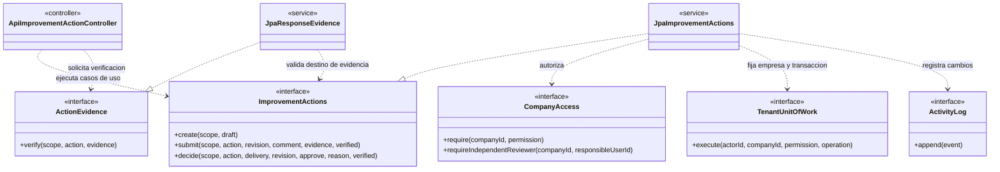
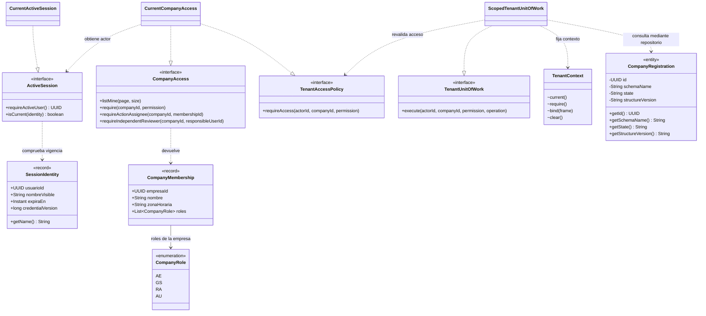
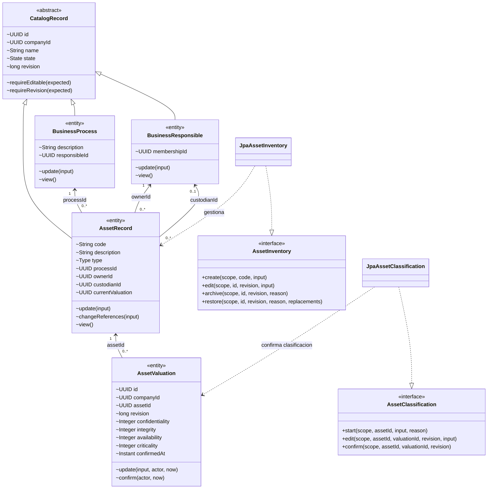
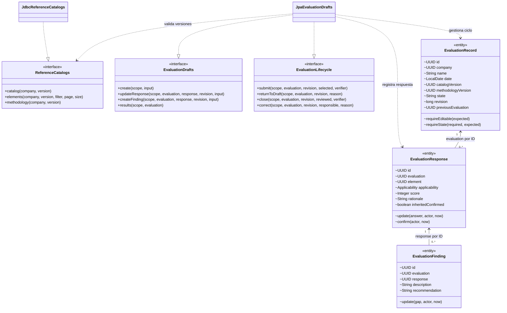
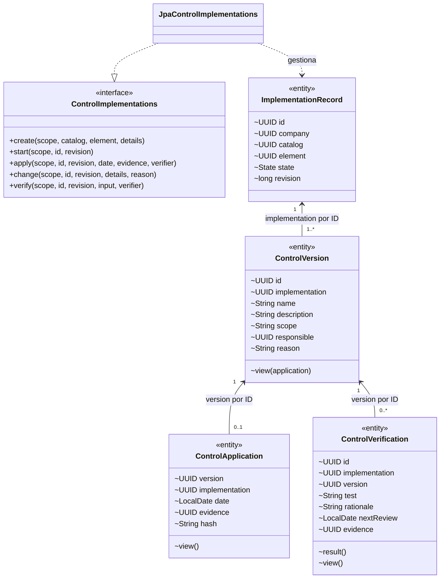
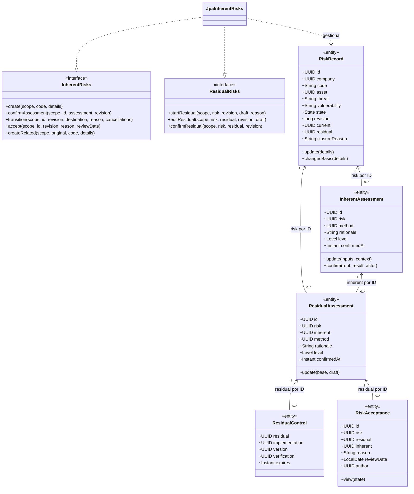
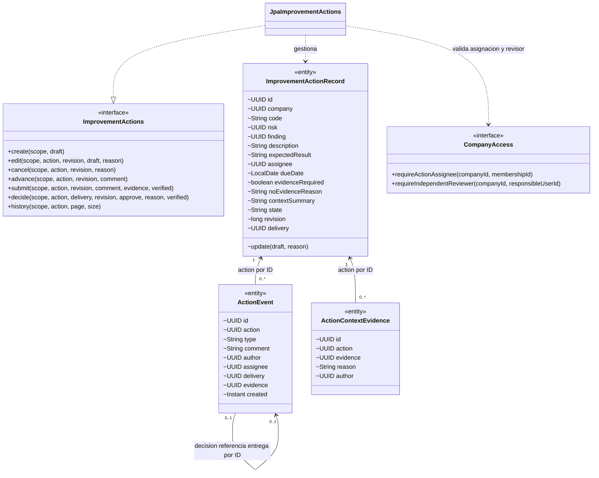
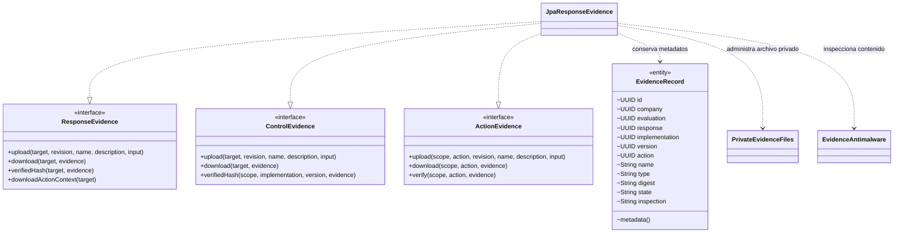
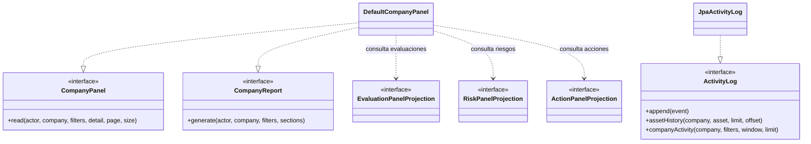

# Diagrama de clases del sistema MSPI

Versión: 1.0
Fecha: 10 de noviembre de 2026
Base de código revisada: backend local, rama `Develop`, commit `d36f7f720380decff4bc614b720b6b9377081130`.

## 1. Alcance y lectura

Este documento presenta las clases, contratos, atributos y operaciones principales del backend. La vista general muestra la organización de la aplicación y las vistas por módulo desarrollan el modelo de clases. Se utilizan los nombres Java existentes para facilitar la comparación con el código.

Se seleccionan atributos y operaciones representativos. Los parámetros de los métodos se abrevian para facilitar su lectura. La firma completa, los tipos anidados y las validaciones se consultan en las fuentes enlazadas. Las relaciones entre datos expresadas mediante identificadores se identifican como tales en los diagramas.

| Notación UML | Lectura |
| --- | --- |
| `<<interface>>` | Contrato público que implementa una clase |
| `<<record>>` | Tipo Java de transporte o valor con componentes inmutables |
| `<<entity>>` | Clase persistente JPA del módulo propietario |
| `<<enumeration>>` | Conjunto de valores permitidos |
| `..|>` | Implementación de una interfaz |
| `--|>` | Herencia entre clases |
| `..>` | Dependencia de uso |
| `-->` | Asociación o referencia lógica, indicada por su etiqueta |
| `1`, `0..1`, `0..*` | Uno, opcional o varios elementos asociados |
| `+`, `-`, `~` | Visibilidad pública, privada o de paquete |

Las multiplicidades representan vínculos lógicos entre registros. En el backend, varias entidades conservan un UUID y resuelven el vínculo explícitamente. Una línea marcada «por ID» describe ese vínculo sin introducir un campo de objeto adicional en Java. Las propiedades JPA y los contratos públicos permanecen bajo la responsabilidad de su módulo.

Documentos relacionados: [Diccionario de datos](05-diccionario-de-datos-y-validaciones.md), [Estados y transiciones](06-estados-y-transiciones.md), [Modelo de datos](07-modelo-de-datos-y-aislamiento-por-esquemas.md) y [Arquitectura](08-arquitectura-y-decisiones-tecnicas.md).

## 2. Vista general de clases y contratos

El recorrido de acciones ejemplifica el patrón del monolito modular. `gestion` recibe la solicitud HTTP y coordina los contratos públicos. Los servicios internos aplican reglas, autorización, persistencia y registro de cambios. El controlador entrega funciones de verificación de evidencia a las operaciones que las necesitan, mientras el módulo de evidencias valida el acceso a su objeto de destino.

Fuentes: [Controlador de acciones](../Software_MSPI-back/mspi/src/main/java/software/mspi/gestion/internal/web/ApiImprovementActionController.java), [Servicio de acciones](../Software_MSPI-back/mspi/src/main/java/software/mspi/acciones/internal/persistence/tenant/JpaImprovementActions.java) y [Servicio de evidencias](../Software_MSPI-back/mspi/src/main/java/software/mspi/evidencias/internal/persistence/tenant/JpaResponseEvidence.java).

## 3. Identidad, empresas y contexto autorizado

`CompanyMembership` es el record anidado en `CompanyAccess`. Contiene el conjunto de roles efectivos de la empresa consultada. `CompanyRegistration` representa el registro técnico común de una empresa. El actor y la empresa autorizados determinan la conexión utilizada por la unidad de trabajo.

La atribución AP se administra en el ámbito de plataforma. Los roles empresariales del enum `CompanyRole` son AE, GS, RA y AU. Las asociaciones entre usuarios, membresías e invitaciones del almacenamiento común se desarrollan en el documento 07. El código accede a parte de esas tablas mediante JDBC y records públicos.

Fuentes: [Identidad de sesión](../Software_MSPI-back/mspi/src/main/java/software/mspi/identidad/api/SessionIdentity.java), [Acceso empresarial](../Software_MSPI-back/mspi/src/main/java/software/mspi/empresas/api/CompanyAccess.java), [Autorización actual](../Software_MSPI-back/mspi/src/main/java/software/mspi/empresas/internal/access/CurrentCompanyAccess.java) y [Unidad de trabajo](../Software_MSPI-back/mspi/src/main/java/software/mspi/empresas/internal/tenancy/ScopedTenantUnitOfWork.java).

## 4. Procesos, responsables y activos

`CatalogRecord` es una superclase JPA marcada con `@MappedSuperclass`. Sus campos y comprobaciones se heredan en procesos, responsables y activos. El propietario y el custodio son responsables de negocio, cuya asociación con una membresía es opcional. La clasificación conserva versiones de C/I/D y calcula la criticidad con las dimensiones completas conforme APR-02.

Fuentes: [Superclase del catálogo](../Software_MSPI-back/mspi/src/main/java/software/mspi/activos/internal/persistence/tenant/CatalogRecord.java), [Activo](../Software_MSPI-back/mspi/src/main/java/software/mspi/activos/internal/persistence/tenant/AssetRecord.java), [Valoración del activo](../Software_MSPI-back/mspi/src/main/java/software/mspi/activos/internal/persistence/tenant/AssetValuation.java) y [Contrato de clasificación](../Software_MSPI-back/mspi/src/main/java/software/mspi/activos/api/AssetClassification.java).

## 5. Catálogos y evaluaciones

Cada evaluación queda vinculada a versiones de catálogo y metodología. Las respuestas distinguen aplicabilidad, calificación y fundamento. `EvaluationFinding` conserva la brecha y la recomendación asociadas a una respuesta. La clase `JpaEvaluationDrafts` implementa tanto el contrato de borradores como el ciclo de revisión, cierre y corrección.

Fuentes: [Catálogos](../Software_MSPI-back/mspi/src/main/java/software/mspi/catalogos/api/ReferenceCatalogs.java), [Contrato de borradores](../Software_MSPI-back/mspi/src/main/java/software/mspi/evaluaciones/api/EvaluationDrafts.java), [Ciclo de evaluación](../Software_MSPI-back/mspi/src/main/java/software/mspi/evaluaciones/api/EvaluationLifecycle.java) y [Implementación](../Software_MSPI-back/mspi/src/main/java/software/mspi/evaluaciones/internal/persistence/tenant/JpaEvaluationDrafts.java).

## 6. Implementaciones de controles

`ImplementationRecord` representa el control aplicado en una empresa. `ControlVersion` conserva el detalle versionado. `ControlApplication` registra su puesta en práctica y `ControlVerification` registra la prueba de resultado y su próxima revisión. Esta separación permite conservar la historia cuando cambia una implementación.

Fuentes: [Contrato de implementaciones](../Software_MSPI-back/mspi/src/main/java/software/mspi/controles/api/ControlImplementations.java) y [Clases persistentes de controles](../Software_MSPI-back/mspi/src/main/java/software/mspi/controles/internal/persistence/tenant).

## 7. Riesgos, valoraciones y aceptación

La implementación `JpaInherentRisks` reúne los contratos de valoración inherente, residual y decisiones del ciclo del riesgo. `RiskRecord.current` y `RiskRecord.residual` identifican las valoraciones seleccionadas. `ResidualControl` conserva las verificaciones y versiones consideradas para sustentar el residual. `RiskAcceptance` registra la decisión de AE vinculada a las valoraciones, con próxima revisión conforme APR-09.

Los vínculos entre riesgo e implementación se guardan en `RiskControlLink`. Los cambios que requieren revisión del residual se representan en `ResidualNotice`. El cierre del riesgo se conserva en los campos de `RiskRecord` y su historial.

Fuentes: [Contrato de riesgos](../Software_MSPI-back/mspi/src/main/java/software/mspi/riesgos/api/InherentRisks.java), [Contrato residual](../Software_MSPI-back/mspi/src/main/java/software/mspi/riesgos/api/ResidualRisks.java) y [Clases persistentes de riesgos](../Software_MSPI-back/mspi/src/main/java/software/mspi/riesgos/internal/persistence/tenant).

## 8. Acciones, entregas y revisión independiente

La acción tiene exactamente un origen local, identificado por `risk` o `finding`. El resumen y las evidencias de contexto habilitan la consulta del responsable conforme APR-09. `assignee` identifica la membresía asignada.

Los avances, solicitudes de revisión y decisiones se almacenan como eventos de `ActionEvent`. El campo `delivery` de una decisión referencia el evento de entrega. Una entrega admite como máximo una decisión. Esta representación permite mantener el autor y la asignación originales para comprobar la separación de personas. El servicio aplica los cambios de estado y la revisión esperada.

Fuentes: [Contrato de acciones](../Software_MSPI-back/mspi/src/main/java/software/mspi/acciones/api/ImprovementActions.java), [Acción persistente](../Software_MSPI-back/mspi/src/main/java/software/mspi/acciones/internal/persistence/tenant/ImprovementActionRecord.java), [Eventos de acción](../Software_MSPI-back/mspi/src/main/java/software/mspi/acciones/internal/persistence/tenant/ActionEvent.java) y [Contexto de evidencia](../Software_MSPI-back/mspi/src/main/java/software/mspi/acciones/internal/persistence/tenant/ActionContextEvidence.java).

## 9. Evidencias privadas

`JpaResponseEvidence` implementa los tres contratos de destino, para respuestas de evaluación, versiones de implementación y acciones. Los campos de destino de `EvidenceRecord` identifican el objeto al que pertenece el archivo. El servicio combina permisos del objeto, empresa, revisión, cuota, integridad del contenido e inspección.

Las evidencias seleccionadas para contexto de una acción se relacionan mediante `ActionContextEvidence`. Su consulta comprueba la habilitación explícita y la asignación vigente. La política funcional de referencias documentales para acciones queda en el estado definido por APR-09.

Fuentes: [Contrato de evidencia de acciones](../Software_MSPI-back/mspi/src/main/java/software/mspi/evidencias/api/ActionEvidence.java), [Implementación de evidencias](../Software_MSPI-back/mspi/src/main/java/software/mspi/evidencias/internal/persistence/tenant/JpaResponseEvidence.java) y [Registro de evidencia](../Software_MSPI-back/mspi/src/main/java/software/mspi/evidencias/internal/persistence/tenant/EvidenceRecord.java).

## 10. Reportes y auditoría

Las proyecciones públicas de cada módulo proporcionan datos de consulta al panel y al reporte. `DefaultCompanyPanel` también utiliza `CompanyAccess`, `TenantUnitOfWork` y `ReferenceCatalogs` para autorizar y contextualizar el resultado. `ActivityLog` ofrece el contrato de registro y consulta de actividad, y `JpaActivityLog` lo implementa.

Fuentes: [Panel y reporte](../Software_MSPI-back/mspi/src/main/java/software/mspi/reportes/internal/DefaultCompanyPanel.java), [Contrato de auditoría](../Software_MSPI-back/mspi/src/main/java/software/mspi/auditoria/api/ActivityLog.java) e [Implementación de auditoría](../Software_MSPI-back/mspi/src/main/java/software/mspi/auditoria/internal/JpaActivityLog.java).

## 11. Trazabilidad y uso del documento

| Módulo | Vista de clases | Referencias funcionales |
| --- | --- | --- |
| identidad y empresas | Sección 3 | DD-01 a DD-06, RF-01 a RF-05 y autorización empresarial |
| activos | Sección 4 | DD-09 a DD-12, CU-09 a CU-12 y clasificación APR-02 |
| catalogos y evaluaciones | Sección 5 | DD-07/DD-08/DD-13 a DD-15, CU-13 a CU-16 |
| controles | Sección 6 | DD-16, CU-19 e implementación/verificación |
| riesgos | Sección 7 | DD-17 a DD-20, CU-17 a CU-21, HU-020/HU-021/HU-022 |
| acciones | Sección 8 | DD-21/DD-22, CU-22 a CU-24, HU-023/HU-024 y APR-09 |
| evidencias | Sección 9 | DD-23/DD-24, CU-25 y permisos por objeto |
| reportes y auditoria | Sección 10 | DD-25/DD-26, CU-26 a CU-28 |
| gestion | Sección 2 | Coordinación HTTP y contratos de los módulos, ARQ-07 |

Para presentar el diseño, comenzar por la sección 2 y desarrollar el módulo correspondiente. Las secciones 4 a 9 muestran atributos y operaciones del negocio. El documento 07 complementa esta vista con tablas, claves y cardinalidades del modelo de datos.

La revisión documental contrasta los nombres, atributos, métodos seleccionados e implementaciones de interfaces con el código del commit indicado. La ejecución y resultados de pruebas del backend se consultan en las fichas HU y su CI. Al cambiar una clase o su contrato, actualizar su vista y la referencia de código revisada.
